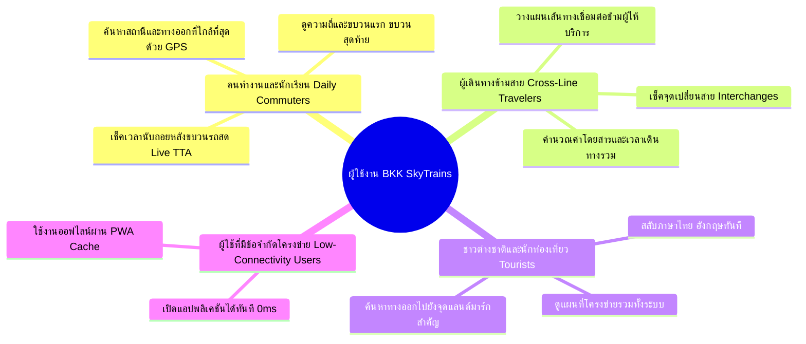
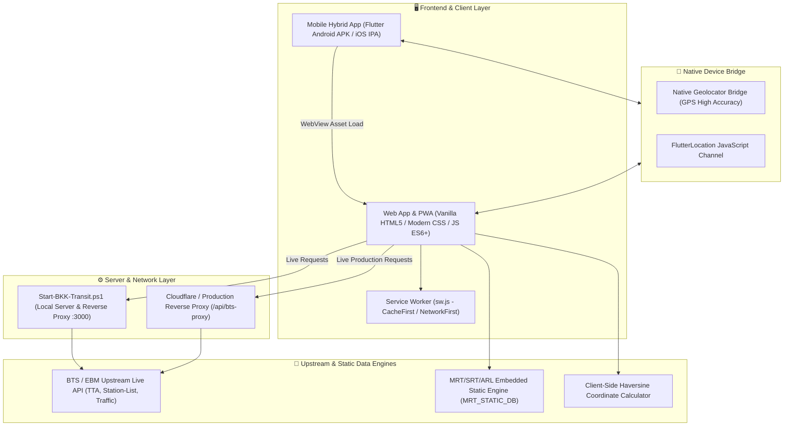
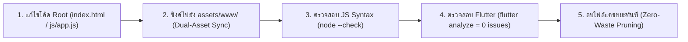

# 📋 Product Requirements Document (PRD)
## BKK SKYTRAINs — Bangkok Transit Real-Time Web & Mobile Ecosystem

---

| เอกสาร | รายละเอียด |
| :--- | :--- |
| **ชื่อผลิตภัณฑ์** | **BKK SKYTRAINs** (Bangkok SkyTrains & Mass Transit Companion) |
| **เวอร์ชันเอกสาร** | 1.3.0 (Production Release) |
| **สถานะ** | Active / Production |
| **แพลตฟอร์มที่รองรับ** | Progressive Web App (PWA), Android (Native Hybrid APK), iOS (Native Hybrid IPA) |
| **กลุ่มเป้าหมาย** | ผู้โดยสารรถไฟฟ้าในกรุงเทพฯ และปริมณฑล (คนไทย, ชาวต่างชาติ, นักท่องเที่ยว) |
| **ผู้พัฒนา / ผู้ดูแล** | ทีมพัฒนา BKK SkyTrains Transit Engineering Team |

---

## 1. วิสัยทัศน์และภาพรวมผลิตภัณฑ์ (Product Vision & Executive Summary)

### 1.1 ที่มาและปัญหา (Problem Statement)
ระบบขนส่งมวลชนทางรางในเขตกรุงเทพมหานครและปริมณฑลประกอบด้วยผู้ให้บริการหลายราย (BTS, MRT, SRTET, ARL) โดยแต่ละระบบมีแอปพลิเคชันและฐานข้อมูลแยกส่วนกัน ทำให้ผู้ใช้งานต้องเผชิญกับปัญหา:
1. **ขาดการแจ้งเตือนเวลารถเข้าชานชาลาแบบเรียลไทม์ (Live TTA)** ที่รวดเร็วและแม่นยำในหน้าจอเดียว
2. **การวางแผนเดินทางข้ามโครงข่าย (Cross-Network Journey Planning)** มีความซับซ้อน ไม่สามารถคำนวณเวลาและค่าโดยสารรวมแบบข้ามสายได้อย่างแม่นยำ
3. **ขาดข้อมูลทางออกสถานีและจุดเชื่อมต่อ (Station Exits & Facilities)** เช่น ทางออกที่ใกล้ที่สุด, ลิฟต์, บันไดเลื่อน หรือสกายวอล์ก
4. **ความหน่วงและการกินทรัพยากรของแอปพลิเคชัน** แอปขนส่งมักมีขนาดใหญ่และต้องพึ่งพาอินเทอร์เน็ตความเร็วสูงตลอดเวลา

### 1.2 วิสัยทัศน์ของผลิตภัณฑ์ (Product Vision)
**BKK SKYTRAINs** มุ่งมั่นที่จะเป็น **"All-in-One Real-Time Transit Companion"** ที่เร็วที่สุด ใช้งานง่ายที่สุด และครอบคลุมโครงข่ายรถไฟฟ้าทุกสายในกรุงเทพฯ และปริมณฑล 100% ภายใต้คอนเซปต์ **Lightweight, Real-Time, Offline-Ready, and Cross-Platform**

---

## 2. กลุ่มผู้ใช้งานและสถานการณ์การใช้งาน (Target Personas & Use Cases)



1. **Daily Commuter (คนทำงาน / นักเรียนประจำวัน):**
   - *เป้าหมาย:* ทราบเวลารถเข้าชานชาลาล่วงหน้าเป็นวินาที เพื่อกะเวลาเดินขึ้นชานชาลาได้พอดี ไม่ต้องยืนรอขบวนรถนาน
   - *ฟีเจอร์หลักที่ใช้:* Live TTA Countdown (ชานชาลา 1 & 2), Live Traffic Status
2. **Cross-Line Traveler (ผู้เดินทางข้ามสาย / ข้ามค่าย):**
   - *เป้าหมาย:* ทราบสถานีเชื่อมต่อที่ดีที่สุด (เช่น สยาม, อโศก-สุขุมวิท, หมอชิต-จตุจักร, ท่าพระ) และค่าโดยสารรวม
   - *ฟีเจอร์หลักที่ใช้:* Smart Journey Planner, Fares Guide, Route Strips
3. **Tourist / Non-Thai Resident (นักท่องเที่ยวและชาวต่างชาติ):**
   - *เป้าหมาย:* ดูผังเส้นทาง เข้าใจชื่อสถานีทั้งภาษาไทยและอังกฤษ และค้นหาทางออกที่เชื่อมต่อไปยังห้างสรรพสินค้าหรือโรงแรม
   - *ฟีเจอร์หลักที่ใช้:* Bilingual Toggle (TH/EN), Station Exits & Facilities, Interactive Map
4. **Offline / Low-Connectivity User:**
   - *เป้าหมาย:* ตรวจสอบผังสถานี ค่าโดยสาร และตารางเวลาได้แม้ขณะอยู่ในชั้นใต้ดินที่ไม่มีสัญญาณอินเทอร์เน็ต
   - *ฟีเจอร์หลักที่ใช้:* PWA Service Worker Cache, Flutter Local Embedded Assets (`assets/www/`)

---

## 3. สถาปัตยกรรมระบบ (System Architecture & Tech Stack)

โครงสร้างระบบถูกออกแบบให้ทำงานร่วมกันแบบ Decoupled และ Hybrid Architecture:



### 3.1 Technology Stack Matrix
- **Core Web Frontend:** Vanilla JavaScript (ES2022+), Semantic HTML5, CSS Variables, Responsive Grid & Flexbox (No React/Vue overhead).
- **Offline & PWA:** Service Worker (`sw.js`), Web App Manifest (`manifest.json`), LocalStorage Cache Engine.
- **Mobile Platform:** Flutter 3.x Multi-platform (Dart), `webview_flutter`, `geolocator`, Android SDK 34+, iOS Xcode 15+.
- **Backend / Reverse Proxy:** Node.js HTTP Server / PowerShell TCP Proxy (`Start-BKK-Transit.ps1`) สำหรับรับส่งข้อมูลข้าม CORS กับ API ของ BTS EBM.
- **CI/CD & Cloud Build:** GitHub Actions (`.github/workflows/build_ios.yml`) บน macOS-14 Runner สร้างไฟล์ `.ipa` อัตโนมัติ.

---

## 4. ข้อกำหนดเชิงฟังก์ชัน (Functional Requirements)

### FR-1: ระบบเช็คเวลารถไฟฟ้าแบบเรียลไทม์ (Live TTA Countdown)
- **FR-1.1:** แสดงผลเวลานับถอยหลัง (ชั่วโมง:นาที:วินาที หรือ นาที:วินาที) ของขบวนรถที่จะเทียบชานชาลาทั้งชานชาลา 1 และ 2 แบบเรียลไทม์
- **FR-1.2:** แสดงลำดับขบวนรถที่จะมาถึงต่อเนื่องสูงสุด 3 ขบวนต่อชานชาลา
- **FR-1.3:** เมื่อขบวนรถเข้าเทียบชานชาลา (0 นาที / เวลาถึง) ให้แสดงสถานะกะพริบเตือนสีแดง "มาแล้ว / Arrived"
- **FR-1.4:** ระบบต้อง Polling ดึงข้อมูลใหม่ทุก 20 วินาที (`REFRESH_MS = 20000`) และ Tick นาฬิกาทุก 1 วินาที (`TICK_MS = 1000`)
- **FR-1.5:** กรณีที่สถานีไม่มีข้อมูลสดแบบเรียลไทม์ (เช่น MRT สายสีน้ำเงิน/ม่วง) ระบบจะต้องแสดงเวลาตามตารางความถี่เดินรถ (Timetable Headway) อัตโนมัติ

### FR-2: ระบบพิกัด GPS และตรวจจับสถานีใกล้เคียง (Nearest Station & Exit by GPS)
- **FR-2.1:** คำนวณระยะทางจากพิกัดปัจจุบันของผู้ใช้ไปยังสถานีทั้งหมดด้วยสูตร **Haversine Formula**:
  $$d = 2r \arcsin\left(\sqrt{\sin^2\left(\frac{\Delta \phi}{2}\right) + \cos(\phi_1)\cos(\phi_2)\sin^2\left(\frac{\Delta \lambda}{2}\right)}\right)$$
- **FR-2.2:** ระบุสถานีที่ใกล้ที่สุดโดยอัตโนมัติพร้อมระยะทาง (กม. หรือ ม.)
- **FR-2.3:** แสดงชิปสถานีใกล้เคียงสำรอง (Alternative Nearest Stations) ในระยะไม่เกิน 120 กม.
- **FR-2.4:** ค้นหาและแนะนำประตูทางออกสถานี (Exit Door) ที่ใกล้กับตำแหน่งพิกัดของผู้ใช้งานมากที่สุด
- **FR-2.5:** Fallback Mechanism: หากผู้ใช้ปฏิเสธ GPS หรือระบุตำแหน่งไม่ได้ภายใน 5 วินาที ให้ใช้สถานีศูนย์กลางการเดินทางสำรอง (สถานีอโศก `E4` / สยาม `CEN`)

### FR-3: ผังสายรถไฟฟ้าแบบโต้ตอบ (Interactive Route Strip & Line Network)
- **FR-3.1:** แสดงผังเส้นทางเดินรถแบบ Strip ครอบคลุมโครงข่ายรถไฟฟ้าทั้งหมดในกรุงเทพฯ และปริมณฑล:
  - BTS สายสุขุมวิท (Light Green - LineId: 1)
  - BTS สายสีลม (Dark Green - LineId: 2)
  - BTS สายสีทอง (Gold - LineId: 3)
  - MRT สายสีเหลือง (Yellow Monorail - LineId: 4)
  - MRT สายสีชมพู (Pink Monorail - LineId: 5)
  - MRT สายสีน้ำเงิน (Blue Ring Line - LineId: 101)
  - MRT สายสีม่วง (Purple Line - LineId: 102)
  - SRTET สายสีแดงเข้ม/แดงอ่อน (Thani Ratthaya & Nakhon Withi - LineId: 103)
  - ARL รถไฟฟ้าแอร์พอร์ต เรล ลิงก์ (Airport Rail Link - LineId: 104)
- **FR-3.2:** ผู้ใช้สามารถแตะเลือกสถานีใดๆ บนผังเพื่อเปิดแผ่นข้อมูลรายละเอียด (Station Bottom Sheet) ได้ทันที
- **FR-3.3 (Mandatory Icon Standard):** ทุกจุดที่แสดงสัญลักษณ์สายสี ต้องใช้ไอคอนรูปรถไฟเฉพาะประจำสายสีผ่าน `getLineIconSvg(lineId)` ห้ามใช้จุดกลมหรือไอคอนรถไฟทั่วไปเด็ดขาด

### FR-4: ระบบวางแผนการเดินทางอัจฉริยะ (Smart Journey Planner)
- **FR-4.1:** ผู้ใช้สามารถเลือกสถานีต้นทาง (Origin) และสถานีปลายทาง (Destination) ได้อย่างอิสระข้ามทุกสาย
- **FR-4.2:** คำนวณเส้นทางด้วยอัลกอริทึมกราฟ (Dijkstra / BFS Traversal) โดยมีค่าน้ำหนักการเปลี่ยนสาย (Transfer Penalty Weight = 5 นาที)
- **FR-4.3:** แสดงข้อมูลสรุปการเดินทาง:
  - เวลาเดินทางรวมโดยประมาณ (Estimated Journey Duration)
  - จำนวนสถานีทั้งหมดที่ผ่าน (Total Station Count)
  - จุดเปลี่ยนขบวนและสายรถไฟฟ้าที่ต้องต่อ (Interchanges & Transfers)
  - ค่าโดยสารรวมโดยประมาณ (Estimated Total Fare)
- **FR-4.4:** แสดงแผนผังขั้นตอนการเดินทางทีละสเต็ป (Step-by-step Route Guidance) พร้อมไอคอนสายสี

### FR-5: ข้อมูลทางออกและสิ่งอำนวยความสะดวก (Station Exits & Facilities)
- **FR-5.1:** แสดงรายการประตูทางออก (Exit 1, 2, 3, 4...) ของแต่ละสถานี
- **FR-5.2:** ระบุสถานที่สำคัญ, อาคารสำนักงาน, โรงแรม, แหล่งช็อปปิ้ง และจุดต่อรถประจำทางของแต่ละทางออก
- **FR-5.3:** ระบุสิ่งอำนวยความสะดวก: บันไดเลื่อน (Escalators), ลิฟต์คนพิการ/ผู้สูงอายุ (Elevators), ทางเชื่อมสกายวอล์ก (Skywalks)

### FR-6: ตารางและโครงสร้างค่าโดยสาร (Fares & Pricing Guide)
- **FR-6.1:** แสดงอัตราค่าโดยสารตามระยะทางของแต่ละสาย (BTS, MRT, SRT, ARL)
- **FR-6.2:** แสดงเงื่อนไขส่วนลด (นักเรียน/นักศึกษา, ผู้สูงอายุ) และนโยบายตั๋วร่วม / ตั๋วเหมาจ่าย (ถ้ามี)
- **FR-6.3:** คำนวณค่าโดยสารแบบไดนามิกระหว่าง 2 สถานีในระบบ

### FR-7: ตารางเวลาเดินรถและความถี่ (Timetables & Train Frequencies)
- **FR-7.1:** ข้อมูลขบวนรถเที่ยวแรก (First Train) และเที่ยวสุดท้าย (Last Train) ของแต่ละสถานีและแต่ละสาย
- **FR-7.2:** ข้อมูลความถี่การปล่อยขบวนรถ (Headway):
  - ช่วงเวลาเร่งด่วนเช้า-เย็น (Peak Hours: 07:00-09:00, 17:00-20:00)
  - ช่วงเวลาปกติ (Off-Peak Hours) และวันหยุดสุดสัปดาห์

### FR-8: สถานะการให้บริการสด (Live Traffic & Incident Ticker)
- **FR-8.1:** ดึงข้อมูลสถานะการเดินรถจากศูนย์ควบคุมทุก 3 นาที (`TRAFFIC_REFRESH_MS = 180000`)
- **FR-8.2:** แสดงแถบสถานะสีเขียว (ปกติ) / สีเหลือง (ล่าช้า) / สีแดง (ขัดข้อง) พร้อมข้อความแจ้งเตือนรายละเอียดเหตุขัดข้อง

### FR-9: รองรับ 2 ภาษาและการปรับแต่งรูปลักษณ์ (Bilingual & Theming)
- **FR-9.1:** สลับภาษาระหว่างภาษาไทย (TH) และภาษาอังกฤษ (EN) ได้แบบทันที 0ms ทั่วทั้งแอป
- **FR-9.2:** สลับธีม Dark Mode (Slate Dark #0F172A) และ Light Mode ได้อย่างราบรื่น
- **FR-9.3:** บันทึกการตั้งค่าภาษาและธีมลงใน `localStorage` ให้คงอยู่ตลอดการใช้งาน

### FR-10: การติดตั้งและการทำงานออฟไลน์ (PWA & Flutter Hybrid App)
- **FR-10.1:** รองรับการติดตั้งแบบ PWA ผ่าน Web App Manifest และ Service Worker
- **FR-10.2:** แอปพลิเคชันมือถือ Flutter บรรจุไฟล์เว็บลงในตัวแอป (`assets/www/`) ทำให้เปิดแอปได้เร็วแบบออฟไลน์
- **FR-10.3:** สื่อสารสองทางระหว่าง Flutter Native กับ WebView ผ่าน `FlutterLocation` Javascript Channel เพื่อเรียกตำแหน่ง GPS ความแม่นยำสูง

---

## 5. ข้อกำหนดที่ไม่ใช่เชิงฟังก์ชัน (Non-Functional Requirements)

| มิติ | ข้อกำหนด (NFR Specifications) |
| :--- | :--- |
| **ประสิทธิภาพ (Performance)** | - First Contentful Paint (FCP) < 800ms บน 4G<br>- Time to Interactive (TTI) < 1.2 วินาที<br>- 60 FPS Smooth Scrolling & Transitions<br>- การคำนวณ Dijkstra ข้ามทุกสายใช้เวลา < 15ms |
| **ความพร้อมใช้งาน (Availability)** | - รองรับการทำงานออฟไลน์ 100% สำหรับข้อมูลสถานี ผังเส้นทาง และการคำนวณเส้นทาง<br>- Graceful Degradation: หาก BTS API ล่ม ให้สลับใช้ข้อมูล Timetable อัตโนมัติ |
| **ความปลอดภัย (Security)** | - ปลอดสารคุกกี้และ Third-party Tracker ไม่เก็บข้อมูลส่วนบุคคลของผู้ใช้<br>- การเรียก Reverse Proxy มีการป้องกัน Input Sanitization และ CORS Lockdown<br>- ผสานไลบรารี `JSEncrypt` เข้ารหัสความปลอดภัย API payload (RSA)<br>- สคริปต์ทั้งหมดผ่านการปลดบล็อก Zone.Identifier (MOTW) |
| **ความเข้ากันได้ (Compatibility)** | - เบราว์เซอร์: Chrome, Safari iOS, Edge, Samsung Internet, Firefox<br>- สมาร์ตโฟน: Android 8.0+ (API 26+) และ iOS 13.0+ |
| **ขนาดแอปพลิเคชัน (Footprint)** | - PWA Bundle ขนาดเบา < 1.5 MB<br>- Android APK ขนาด < 45 MB |

---

## 6. มาตรฐานดีไซน์และอัตลักษณ์ภาพ (Design System & Branding)

### 6.1 รหัสสีประจำสายรถไฟฟ้า (Transit Brand Colors)
```css
/* Color Palette System */
--bts-sukhumvit : #7AC143;  /* สายสุขุมวิท (สีเขียวอ่อน) */
--bts-silom     : #00805A;  /* สายสีลม (สีเขียวเข้ม) */
--bts-gold      : #C5A059;  /* สายสีทอง */
--mrt-blue      : #1F8FDF;  /* สายสีน้ำเงิน */
--mrt-purple    : #8A2C9B;  /* สายสีม่วง */
--mrt-yellow    : #EDAC15;  /* สายสีเหลือง */
--mrt-pink      : #F06595;  /* สายสีชมพู */
--srt-red       : #C21E25;  /* สายสีแดง (ธานีรัถยา / นครวิถี) */
--arl           : #A11B22;  /* แอร์พอร์ต เรล ลิงก์ */
```

### 6.2 มาตรฐานไอคอนรถไฟประจำสาย (Project Train Icon Standard)
> [!IMPORTANT]
> ทุกจุดในระบบที่มีการแสดงผลสัญลักษณ์สายสี **ต้องเรียกใช้ไอคอน SVG รูปรถไฟเฉพาะสายจากฟังก์ชัน `getLineIconSvg(lineId)` เสมอ**
> - BTS Heavy Rail (สายสุขุมวิท / สีลม): รูปรถไฟฟ้า EMU บนรางยกระดับ (Elevated Viaduct)
> - Monorail (สายสีเหลือง / ชมพู): รูปรถไฟฟ้าโมโนเรลคร่อมรางเดี่ยว (Straddle Monorail)
> - Underground / Blue Line: รูปรถไฟฟ้าใต้ดินพร้อมหัวรถไฟโค้งมน
> - SRT Commuter / ARL: รูปรถไฟชานเมืองและรถไฟความเร็วสูงเชื่อมสนามบิน

---

## 7. แผนการทดสอบและการประกันคุณภาพ (Quality Assurance & Validation)



1. **JavaScript Validation:** รัน `node --check js/app.js` และ `node --check bkk_skytrains_flutter/assets/www/js/app.js` ต้องไม่มี Syntax Error
2. **Flutter / Dart Validation:** รัน `flutter analyze` ภายในโฟลเดอร์ `bkk_skytrains_flutter` ต้องผ่าน 100% (0 errors, 0 warnings)
3. **Encoding Validation:** ตรวจสอบไฟล์ `.ps1` ทุกไฟล์ว่าถูกบันทึกด้วยรูปแบบ `UTF-8 with BOM`
4. **Offline Resilience Test:** ปิดการเชื่อมต่อเครือข่ายและทดสอบการเปิดหน้าเว็บและค้นหาเส้นทาง ต้องทำงานได้ตามปกติ

---

## 8. แผนการพัฒนาในอนาคต (Product Roadmap)

- **v1.3.0 (Upcoming):**
  - เพิ่มระบบแจ้งเตือนแบบพุช (Push Notifications) แจ้งเตือนเมื่อใกล้ถึงสถานีปลายทาง
  - ระบบรายงานความหนาแน่นของผู้โดยสารบนชานชาลาแบบ Crowdsourced
- **v1.4.0 (Future):**
  - แผนที่สามมิติ (3D Station Concourse & Platform Map) สำหรับสถานีขนาดใหญ่ (เช่น สยาม, อโศก, บางซื่อ)
  - บูรณาการระบบเรือโดยสารคลองแสนแสบ และเรือด่วนเจ้าพระยา เข้าสู่ Smart Journey Planner
