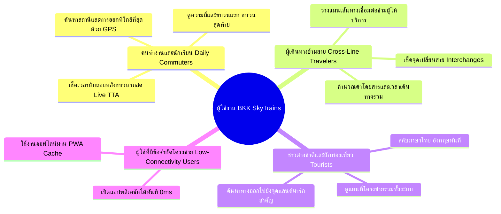
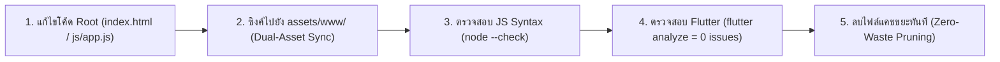

#  Product Requirements Document (PRD)
## BKK SKYTRAINs — Bangkok Transit Real-Time Web & Mobile Ecosystem

---

| เอกสาร | รายละเอียด |
| :--- | :--- |
| **ชื่อผลิตภัณฑ์** | **BKK SKYTRAINs** (Bangkok SkyTrains & Mass Transit Companion) |
| **เวอร์ชันเอกสาร** | 1.3.6 (Production Release) |
| **สถานะ** | Active / Production |
| **แพลตฟอร์มที่รองรับ** | Progressive Web App (PWA), Android (Native Hybrid APK), iOS (Native Hybrid IPA) |
| **กลุ่มเป้าหมาย** | ผู้โดยสารรถไฟฟ้าในกรุงเทพฯ และปริมณฑล (คนไทย, ชาวต่างชาติ, นักท่องเที่ยว) |
| **ผู้พัฒนา / ผู้ดูแล** | ทีมพัฒนา BKK SkyTrains Transit Engineering Team |

---

## 1. วิสัยทัศน์และภาพรวมผลิตภัณฑ์ (Product Vision & Executive Summary)

### 1.1 ที่มาและปัญหา (Problem Statement)
ระบบขนส่งมวลชนทางรางในเขตกรุงเทพมหานครและปริมณฑลประกอบด้วยผู้ให้บริการหลายราย (BTS, MRT, SRTET, ARL) โดยแต่ละระบบมีแอปพลิเคชันและฐานข้อมูลแยกส่วนกัน ทำให้ผู้ใช้งานต้องเผชิญกับปัญหา:
1. **ขาดการแจ้งเตือนเวลารถเข้าชานชาลาแบบเรียลไทม์ (Live TTA)** ที่รวดเร็วและแม่นยำในหน้าจอเดียว
2. **การวางแผนเดินทางข้ามโครงข่าย (Cross-Network Journey Planning)** มีความซับซ้อน ไม่สามารถคำนวณเวลาและค่าโดยสารรวมแบบข้ามสายได้อย่างแม่นยำ
3. **ขาดข้อมูลทางออกสถานีและจุดเชื่อมต่อ (Station Exits & Facilities)** เช่น ทางออกที่ใกล้ที่สุด, ลิฟต์, บันไดเลื่อน หรือสกายวอล์ก
4. **ความหน่วงและการกินทรัพยากรของแอปพลิเคชัน** แอปขนส่งมักมีขนาดใหญ่และต้องพึ่งพาอินเทอร์เน็ตความเร็วสูงตลอดเวลา

### 1.2 วิสัยทัศน์ของผลิตภัณฑ์ (Product Vision)
**BKK SKYTRAINs** มุ่งมั่นที่จะเป็น **"All-in-One Real-Time Transit Companion"** ที่เร็วที่สุด ใช้งานง่ายที่สุด และครอบคลุมโครงข่ายรถไฟฟ้าทุกสายในกรุงเทพฯ และปริมณฑล 100% ภายใต้คอนเซปต์ **Lightweight, Real-Time, Offline-Ready, and Cross-Platform**

---

## 2. กลุ่มผู้ใช้งานและสถานการณ์การใช้งาน (Target Personas & Use Cases)



1. **Daily Commuter (คนทำงาน / นักเรียนประจำวัน):**
   - *เป้าหมาย:* ทราบเวลารถเข้าชานชาลาล่วงหน้าเป็นวินาที เพื่อกะเวลาเดินขึ้นชานชาลาได้พอดี ไม่ต้องยืนรอขบวนรถนาน
   - *ฟีเจอร์หลักที่ใช้:* Live TTA Countdown (ชานชาลา 1 & 2), Live Traffic Status
2. **Cross-Line Traveler (ผู้เดินทางข้ามสาย / ข้ามค่าย):**
   - *เป้าหมาย:* ทราบสถานีเชื่อมต่อที่ดีที่สุด (เช่น สยาม, อโศก-สุขุมวิท, หมอชิต-จตุจักร, ท่าพระ) และค่าโดยสารรวม
   - *ฟีเจอร์หลักที่ใช้:* Smart Journey Planner, Fares Guide, Route Strips
3. **Tourist / Non-Thai Resident (นักท่องเที่ยวและชาวต่างชาติ):**
   - *เป้าหมาย:* ดูผังเส้นทาง เข้าใจชื่อสถานีทั้งภาษาไทยและอังกฤษ และค้นหาทางออกที่เชื่อมต่อไปยังห้างสรรพสินค้าหรือโรงแรม
   - *ฟีเจอร์หลักที่ใช้:* Bilingual Toggle (TH/EN), Station Exits & Facilities, Interactive Map
4. **Offline / Low-Connectivity User:**
   - *เป้าหมาย:* ตรวจสอบผังสถานี ค่าโดยสาร และตารางเวลาได้แม้ขณะอยู่ในชั้นใต้ดินที่ไม่มีสัญญาณอินเทอร์เน็ต
   - *ฟีเจอร์หลักที่ใช้:* PWA Service Worker Cache, Flutter Local Embedded Assets (`assets/www/`)

---

## 3. สถาปัตยกรรมระบบ (System Architecture & Tech Stack)

โครงสร้างระบบถูกออกแบบให้ทำงานร่วมกันแบบ Decoupled และ Hybrid Architecture:

```mermaid
flowchart TD
    subgraph ClientLayer["🖥️ Frontend & Client Layer"]
        WebPWA["Web App & PWA (Vanilla HTML5 / Modern CSS / JS ES6+)"]
        FlutterApp["Mobile Hybrid App (Flutter Android APK / iOS IPA)"]
        SW["Service Worker (sw.js - CacheFirst / NetworkFirst)"]
    end

    subgraph NativeBridge["📱 Native Device Bridge"]
        Geolocator["Native Geolocator Bridge (GPS High Accuracy)"]
        JSChannel["FlutterLocation JavaScript Channel"]
    end

    subgraph ServerProxyLayer["⚙️ Server & Network Layer"]
        PSLocal["Start-BKK-Transit.ps1 (Local Server & Reverse Proxy :3000)"]
        RemoteProxy["Cloudflare / Production Reverse Proxy (/api/bts-proxy)"]
    end

    subgraph DataSources["🚊 Upstream & Static Data Engines"]
        BTSLive["BTS / EBM Upstream Live API (TTA, Station-List, Traffic)"]
        MRTStatic["MRT/SRT/ARL Embedded Static Engine (MRT_STATIC_DB)"]
        Haversine["Client-Side Haversine Coordinate Calculator"]
    end

    WebPWA --> SW
    FlutterApp -->|WebView Asset Load| WebPWA
    FlutterApp <--> NativeBridge
    NativeBridge <--> WebPWA
    WebPWA -->|Live Requests| PSLocal
    WebPWA -->|Live Production Requests| RemoteProxy
    PSLocal --> BTSLive
    RemoteProxy --> BTSLive
    WebPWA --> MRTStatic
    WebPWA --> Haversine
```



### 3.1 Technology Stack Matrix
- **Core Web Frontend:** Vanilla JavaScript (ES2022+), Semantic HTML5, CSS Variables, Responsive Grid & Flexbox (No React/Vue overhead).
- **Offline & PWA:** Service Worker (`sw.js`), Web App Manifest (`manifest.json`), LocalStorage Cache Engine.
- **Mobile Platform:** Flutter 3.x Multi-platform (Dart), `webview_flutter`, `geolocator`, Android SDK 34+, iOS Xcode 15+.
- **Backend / Reverse Proxy:** Vercel Serverless Function (`api/bts-proxy.js`) & Local Node.js Server (`Start-BKK-Transit.ps1`) สำหรับรับส่งข้อมูลและปลดล็อก CORS กับเซิร์ฟเวอร์ระบบ BTS / EBM ได้อย่างปลอดภัย.
- **CI/CD & Cloud Build:** GitHub Actions (`.github/workflows/build_ios.yml`) บน macOS-14 Runner สร้างไฟล์ `.ipa` อัตโนมัติ (สำหรับ Private Repository ต้องตั้งค่า Spending Limit บน GitHub Actions ให้มากกว่า $0).

---

## 4. ข้อกำหนดเชิงฟังก์ชัน (Functional Requirements)

### FR-1: ระบบเช็คเวลารถไฟฟ้าแบบเรียลไทม์ (Live TTA Countdown)
- **FR-1.1:** แสดงผลเวลานับถอยหลัง (ชั่วโมง:นาที:วินาที หรือ นาที:วินาที) ของขบวนรถที่จะเทียบชานชาลาทั้งชานชาลา 1 และ 2 แบบเรียลไทม์
- **FR-1.2:** แสดงลำดับขบวนรถที่จะมาถึงต่อเนื่องสูงสุด 3 ขบวนต่อชานชาลา
- **FR-1.3:** เมื่อขบวนรถเข้าเทียบชานชาลา (0 นาที / เวลาถึง) ให้แสดงสถานะกะพริบเตือนสีแดง "มาแล้ว / Arrived"
- **FR-1.4:** ระบบต้อง Polling ดึงข้อมูลใหม่ทุก 20 วินาที (`REFRESH_MS = 20000`) และ Tick นาฬิกาทุก 1 วินาที (`TICK_MS = 1000`)
- **FR-1.5:** กรณีที่สถานีไม่มีข้อมูลสดแบบเรียลไทม์ (เช่น MRT สายสีน้ำเงิน/ม่วง) ระบบจะต้องแสดงเวลาตามตารางความถี่เดินรถ (Timetable Headway) อัตโนมัติ

### FR-2: ระบบพิกัด GPS และตรวจจับสถานีใกล้เคียง (Nearest Station & Exit by GPS)
- **FR-2.1:** คำนวณระยะทางจากพิกัดปัจจุบันของผู้ใช้ไปยังสถานีทั้งหมดด้วยสูตร **Haversine Formula**:
  $$d = 2r \arcsin\left(\sqrt{\sin^2\left(\frac{\Delta \phi}{2}\right) + \cos(\phi_1)\cos(\phi_2)\sin^2\left(\frac{\Delta \lambda}{2}\right)}\right)$$
- **FR-2.2:** ระบุสถานีที่ใกล้ที่สุดโดยอัตโนมัติพร้อมระยะทาง (กม. หรือ ม.)
- **FR-2.3:** แสดงชิปสถานีใกล้เคียงสำรอง (Alternative Nearest Stations) ในระยะไม่เกิน 120 กม.
- **FR-2.4:** ค้นหาและแนะนำประตูทางออกสถานี (Exit Door) ที่ใกล้กับตำแหน่งพิกัดของผู้ใช้งานมากที่สุด
- **FR-2.5:** Fallback Mechanism: หากผู้ใช้ปฏิเสธ GPS หรือระบุตำแหน่งไม่ได้ภายใน 5 วินาที ให้ใช้สถานีศูนย์กลางการเดินทางสำรอง (สถานีอโศก `E4` / สยาม `CEN`)

### FR-3: ผังสายรถไฟฟ้าแบบโต้ตอบ (Interactive Route Strip & Line Network)
- **FR-3.1:** แสดงผังเส้นทางเดินรถแบบ Strip ครอบคลุมโครงข่ายรถไฟฟ้าทั้งหมดในกรุงเทพฯ และปริมณฑล:
  -  BTS สายสุขุมวิท (Light Green - LineId: 1, `#7AB420`)
  -  BTS สายสีลม (Dark Green / Teal - LineId: 2, `#00807D`)
  -  BTS สายสีทอง (Gold APM - LineId: 3, `#C9A038`)
  -  MRT สายสีเหลือง (นัคราพิพัฒน์ - Yellow Monorail - LineId: 4, `#FFD100`)
  -  MRT สายสีชมพู (วิวัฒน์นคร - Pink Monorail - LineId: 5, `#EC4899`, พร้อมสายแยกเมืองทอง MT01-MT02)
  -  MRT สายสีน้ำเงิน (เฉลิมรัชมงคล - Blue Metro - LineId: 101, `#0284C7`)
  -  MRT สายสีม่วง (ฉลองรัชธรรม - Purple Heavy Rail - LineId: 102, `#8A2C9B`)
  -  SRTET สายสีแดงเข้ม (ธานีรัถยา - Dark Red - LineId: 103, `#B91C1C`)
  -  SRTET สายสีแดงอ่อน (นครวิถี - Light Red - LineId: 105, `#F87171`)
  -  ARL รถไฟฟ้าแอร์พอร์ต เรล ลิงก์ (Airport Rail Link - LineId: 104, `#8A1538`)
  -  BRT รถโดยสารด่วนพิเศษ (Bus Rapid Transit - LineId: 201, `#82C341`)
  -  MRT สายสีส้ม (Orange Line - LineId: 106, `#F58220`, โครงการในอนาคต)
- **FR-3.2:** ผู้ใช้สามารถแตะเลือกสถานีใดๆ บนผังเพื่อเปิดแผ่นข้อมูลรายละเอียด (Station Bottom Sheet) ได้ทันที
- **FR-3.3 (Mandatory Icon Standard):** ทุกจุดที่แสดงสัญลักษณ์สายสี ต้องใช้ไอคอน SVG รูปรถไฟเฉพาะประจำสายสีผ่าน `getLineIconSvg(lineId)` ห้ามใช้จุดกลม (●) หรือไอคอนรถไฟทั่วไปที่ไม่ตรงกับสายเด็ดขาด

### FR-4: ระบบวางแผนการเดินทางอัจฉริยะ (Smart Journey Planner)
- **FR-4.1:** ผู้ใช้สามารถเลือกสถานีต้นทาง (Origin) และสถานีปลายทาง (Destination) ได้อย่างอิสระข้ามทุกสาย
- **FR-4.2:** คำนวณเส้นทางด้วยอัลกอริทึมกราฟ (Dijkstra / BFS Traversal) โดยมีค่าน้ำหนักการเปลี่ยนสาย (Transfer Penalty Weight = 5 นาที)
- **FR-4.3:** แสดงข้อมูลสรุปการเดินทาง:
  - เวลาเดินทางรวมโดยประมาณ (Estimated Journey Duration)
  - จำนวนสถานีทั้งหมดที่ผ่าน (Total Station Count)
  - จุดเปลี่ยนขบวนและสายรถไฟฟ้าที่ต้องต่อ (Interchanges & Transfers)
  - ค่าโดยสารรวมโดยประมาณ (Estimated Total Fare)
- **FR-4.4:** แสดงแผนผังขั้นตอนการเดินทางทีละสเต็ป (Step-by-step Route Guidance) พร้อมไอคอนสายสี

### FR-5: ข้อมูลทางออกและสิ่งอำนวยความสะดวก (Station Exits & Facilities)
- **FR-5.1:** แสดงรายการประตูทางออก (Exit 1, 2, 3, 4...) ของแต่ละสถานี
- **FR-5.2:** ระบุสถานที่สำคัญ, อาคารสำนักงาน, โรงแรม, แหล่งช็อปปิ้ง และจุดต่อรถประจำทางของแต่ละทางออก
- **FR-5.3:** ระบุสิ่งอำนวยความสะดวก: บันไดเลื่อน (Escalators), ลิฟต์คนพิการ/ผู้สูงอายุ (Elevators), ทางเชื่อมสกายวอล์ก (Skywalks)

### FR-6: ตารางและโครงสร้างค่าโดยสาร (Fares & Pricing Guide)
- **FR-6.1:** แสดงอัตราค่าโดยสารตามระยะทางของแต่ละสาย (BTS, MRT, SRT, ARL)
- **FR-6.2:** แสดงเงื่อนไขส่วนลด (นักเรียน/นักศึกษา, ผู้สูงอายุ) และนโยบายตั๋วร่วม / ตั๋วเหมาจ่าย (ถ้ามี)
- **FR-6.3:** คำนวณค่าโดยสารแบบไดนามิกระหว่าง 2 สถานีในระบบ

### FR-7: ตารางเวลาเดินรถและความถี่ (Timetables & Train Frequencies)
- **FR-7.1:** ข้อมูลขบวนรถเที่ยวแรก (First Train) และเที่ยวสุดท้าย (Last Train) ของแต่ละสถานีและแต่ละสาย
- **FR-7.2:** ข้อมูลความถี่การปล่อยขบวนรถ (Headway):
  - ช่วงเวลาเร่งด่วนเช้า-เย็น (Peak Hours: 07:00-09:00, 17:00-20:00)
  - ช่วงเวลาปกติ (Off-Peak Hours) และวันหยุดสุดสัปดาห์

### FR-8: สถานะการให้บริการสด (Live Traffic & Incident Ticker)
- **FR-8.1:** ดึงข้อมูลสถานะการเดินรถจากศูนย์ควบคุมทุก 3 นาที (`TRAFFIC_REFRESH_MS = 180000`)
- **FR-8.2:** แสดงแถบสถานะสีเขียว (ปกติ) / สีเหลือง (ล่าช้า) / สีแดง (ขัดข้อง) พร้อมข้อความแจ้งเตือนรายละเอียดเหตุขัดข้อง

### FR-9: รองรับ 2 ภาษาและการปรับแต่งรูปลักษณ์ (Bilingual & Theming)
- **FR-9.1:** สลับภาษาระหว่างภาษาไทย (TH) และภาษาอังกฤษ (EN) ได้แบบทันที 0ms ทั่วทั้งแอป
- **FR-9.2:** สลับธีม Dark Mode (Slate Dark #0F172A) และ Light Mode ได้อย่างราบรื่น
- **FR-9.3:** บันทึกการตั้งค่าภาษาและธีมลงใน `localStorage` ให้คงอยู่ตลอดการใช้งาน

### FR-10: การติดตั้งและการทำงานออฟไลน์ (PWA & Flutter Hybrid App)
- **FR-10.1:** รองรับการติดตั้งแบบ PWA ผ่าน Web App Manifest และ Service Worker
- **FR-10.2:** แอปพลิเคชันมือถือ Flutter บรรจุไฟล์เว็บลงในตัวแอป (`assets/www/`) ทำให้เปิดแอปได้เร็วแบบออฟไลน์
- **FR-10.3:** สื่อสารสองทางระหว่าง Flutter Native กับ WebView ผ่าน `FlutterLocation` Javascript Channel เพื่อเรียกตำแหน่ง GPS ความแม่นยำสูง

---

## 5. ข้อกำหนดที่ไม่ใช่เชิงฟังก์ชัน (Non-Functional Requirements)

| มิติ | ข้อกำหนด (NFR Specifications) |
| :--- | :--- |
| **ประสิทธิภาพ (Performance)** | - First Contentful Paint (FCP) < 800ms บน 4G<br>- Time to Interactive (TTI) < 1.2 วินาที<br>- 60 FPS Smooth Scrolling & Transitions<br>- การคำนวณ Dijkstra ข้ามทุกสายใช้เวลา < 15ms |
| **ความพร้อมใช้งาน (Availability)** | - รองรับการทำงานออฟไลน์ 100% สำหรับข้อมูลสถานี ผังเส้นทาง และการคำนวณเส้นทาง<br>- Graceful Degradation: หาก BTS API ล่ม ให้สลับใช้ข้อมูล Timetable อัตโนมัติ |
| **ความปลอดภัย (Security)** | - ปลอดสารคุกกี้และ Third-party Tracker ไม่เก็บข้อมูลส่วนบุคคลของผู้ใช้<br>- การเรียก Reverse Proxy มีการป้องกัน Input Sanitization และ CORS Lockdown<br>- ผสานไลบรารี `JSEncrypt` เข้ารหัสความปลอดภัย API payload (RSA)<br>- สคริปต์ทั้งหมดผ่านการปลดบล็อก Zone.Identifier (MOTW) |
| **ความเข้ากันได้ (Compatibility)** | - เบราว์เซอร์: Chrome, Safari iOS, Edge, Samsung Internet, Firefox<br>- สมาร์ตโฟน: Android 8.0+ (API 26+) และ iOS 13.0+ |
| **ขนาดแอปพลิเคชัน (Footprint)** | - PWA Bundle ขนาดเบา < 1.5 MB<br>- Android APK ขนาด < 45 MB<br>- Android App Bundle (.aab) ขนาด ~ 45 MB |

---

## 6. มาตรฐานดีไซน์และอัตลักษณ์ภาพ (Design System & Branding)

### 6.1 รหัสสีประจำสายรถไฟฟ้า (Transit Brand Colors)
รหัสสี Hex ประจำสายทั้งหมดสอดคล้องตรงกับระบบเว็บแอปพลิเคชัน (`LINE_BRAND_COLORS` ใน `js/app.js`):
```css
/* Color Palette System */
--bts-sukhumvit : #7AB420;  /* Line 1: สายสุขุมวิท (สีเขียวสว่าง) */
--bts-silom     : #00807D;  /* Line 2: สายสีลม (สีเขียวเข้ม / เขียวนกการเวก) */
--bts-gold      : #C9A038;  /* Line 3: สายสีทอง (สีทอง APM) */
--mrt-yellow    : #FFD100;  /* Line 4: สายสีเหลือง นัคราพิพัฒน์ (สีเหลืองโมโนเรล) */
--mrt-pink      : #EC4899;  /* Line 5: สายสีชมพู วิวัฒน์นคร (สีชมพูโมโนเรล) */
--mrt-blue      : #0284C7;  /* Line 101: สายสีน้ำเงิน เฉลิมรัชมงคล (สีน้ำเงินเมโทร) */
--mrt-purple    : #8A2C9B;  /* Line 102: สายสีม่วง ฉลองรัชธรรม (สีม่วง) */
--srt-dark-red  : #B91C1C;  /* Line 103: สายสีแดงเข้ม ธานีรัถยา (สีแดงเข้ม รฟท.) */
--srt-light-red : #F87171;  /* Line 105: สายสีแดงอ่อน นครวิถี (สีแดงสว่าง รฟท.) */
--arl           : #8A1538;  /* Line 104: แอร์พอร์ต เรล ลิงก์ (สีแดงเลือดหมู/มารูน) */
--brt           : #82C341;  /* Line 201: รถโดยสารด่วนพิเศษ BRT (สีเขียวตอง) */
--mrt-orange    : #F58220;  /* Line 106: สายสีส้ม (สีส้มเมโทร - โครงการในอนาคต) */
```

### 6.2 มาตรฐานไอคอนรถไฟประจำสาย (Project Train Icon Standard)
> [!IMPORTANT]
> ทุกจุดในระบบที่มีการแสดงผลสัญลักษณ์สายสี **ต้องเรียกใช้ไอคอน SVG รูปรถไฟเฉพาะสายจากฟังก์ชัน `getLineIconSvg(lineId)` เสมอ**
> ห้ามใช้จุดกลม (●) หรือไอคอนรถไฟรูปทรงทั่วไปที่ไม่ตรงกับชนิดขบวนรถจริงโดยเด็ดขาด

| Line ID | สายรถไฟฟ้า | รหัสสี (Hex) | ไอคอนเวกเตอร์ (Vector SVG) | สถาปัตยกรรมตัวรถในไอคอน SVG (getLineIconSvg Architecture) |
| :---: | :--- | :---: | :---: | :--- |
| **1** | **BTS สุขุมวิท** | `#7AB420` |  | **Heavy Rail EMU on Elevated Viaduct:** รูปรถไฟฟ้า EMU วิ่งบนรางยกระดับ พร้อมกระจกหน้าทรงลู่ลม (Aerodynamic Windshield) และไฟหน้าคู่ |
| **2** | **BTS สีลม** | `#00807D` |  | **Heavy Rail EMU on Elevated Viaduct:** รูปรถไฟฟ้า EMU วิ่งบนรางยกระดับ พร้อมกระจกหน้าทรงลู่ลม (Aerodynamic Windshield) และไฟหน้าคู่ |
| **3** | **APM สายสีทอง** | `#C9A038` |  | **Automated People Mover (APM):** ขบวนรถนำทางอัตโนมัติไร้คนขับ กระจกพานอรามาขนาดใหญ่ และรางนำทางคอนกรีตล้อยาง |
| **4** | **MRT สายสีเหลือง** | `#FFD100` |  | **Straddle Monorail:** ขบวนรถไฟฟ้าโมโนเรลทรงแคปซูล ตัวรถคร่อมบนคานคอนกรีตเดี่ยว (Concrete Guide Beam) |
| **5** | **MRT สายสีชมพู** | `#EC4899` |  | **Straddle Monorail:** ขบวนรถไฟฟ้าโมโนเรลทรงแคปซูล ตัวรถคร่อมบนคานคอนกรีตเดี่ยว พร้อมชานชาลาสายแยกเมืองทองธานี |
| **101** | **MRT สายสีน้ำเงิน** | `#0284C7` |  | **Underground Tunnel Metro:** โครงสร้างอุโมงค์ขุดทรงโค้ง (Tunnel Arch) พร้อมขบวนรถไฟใต้ดินไฟหน้าเหลี่ยม |
| **102** | **MRT สายสีม่วง** | `#8A2C9B` |  | **Elevated Sustina EMU:** ขบวนรถไฟฟ้า Heavy Rail เทคโนโลยี Sustina พร้อมทางวิ่งยกระดับและแถบข้างตัวรถ |
| **103** | **SRT สายสีแดงเข้ม** | `#B91C1C` |  | **Commuter EMU (Hitachi):** ขบวนรถไฟชานเมือง พร้อมเสาและขารับกระแสไฟฟ้าเหนือหัว (Overhead Catenary Pantograph) |
| **105** | **SRT สายสีแดงอ่อน** | `#F87171` |  | **Light Commuter EMU:** ขบวนรถไฟชานเมืองสายตะวันตก พร้อมแขนรับกระแสไฟฟ้าแบบแขนเดี่ยว (Single-Arm Pantograph) |
| **104** | **ARL แอร์พอร์ตลิงก์** | `#8A1538` |  | **Airport Express Bullet Train:** ขบวนรถด่วนรูปทรงหัวกระสุน พร้อมสัญลักษณ์เครื่องบินด้านหน้า |
| **201** | **BRT รถโดยสารด่วน** | `#82C341` |  | **Bus Rapid Transit:** รถโดยสารปรับอากาศขนาดใหญ่ พร้อมช่องทางวิ่งเฉพาะ (Dedicated Lane) |
| **106** | **MRT สายสีส้ม** | `#F58220` |  | **Orange Tunnel Metro:** ขบวนรถไฟฟ้าขนส่งมวลชนเชื่อมฝั่งเมืองตะวันออก-ตก (โครงการในอนาคต) |
| **0** | **สถานีรวมทุกสาย** | `#64748B` |  | **Transit Network Hub:** ชุมทางเชื่อมต่อโครงข่ายระบบรางทั้งหมด |

### 6.3 สัญลักษณ์โครงข่ายและจุดเชื่อมต่อ (Transit Network & Legend Symbols)
สัญลักษณ์ทางเชื่อมต่อระบบขนส่งสาธารณะที่แสดงผลในหน้าต่างคำอธิบายโครงข่าย (`#mapLegendSheet`):

| สัญลักษณ์เวกเตอร์ (Vector SVG) | ชื่อเรียก (Legend Name) | รายละเอียดและจุดเชื่อมต่อ (Connectivity) |
| :---: | :--- | :--- |
|  | **จุดเชื่อมต่อข้ามสาย (Interchange)** | โหนดสถานีร่วมวงกลมคู่เชื่อมโยงกัน สำหรับเปลี่ยนขบวนรถข้ามสาย (`.legend-inter-node`) |
|  | **เชื่อมต่อท่าอากาศยาน (Airport)** | เชื่อมต่อไปยังสนามบินสุวรรณภูมิ (ARL) หรือสนามบินดอนเมือง (SRT Red Line) |
|  | **ท่าเรือเชื่อมต่อ (Pier / Boat)** | เชื่อมต่อระบบเรือด่วนเจ้าพระยา และเรือโดยสารคลองแสนแสบ |
|  | **เชื่อมต่อรถไฟทางไกล (SRT)** | เชื่อมต่อไปยังสถานีกลางกรุงเทพอภิวัฒน์ และสถานีรถไฟกรุงเทพ (หัวลำโพง) |
|  | **สถานีขนส่งผู้โดยสาร (Bus Terminal)** | เชื่อมต่อสถานีขนส่งหมอชิต 2, เอกมัย หรือสายใต้ |
|  | **อาคารจอดแล้วจร (Park & Ride)** | จุดบริการลานและอาคารจอดรถเพื่อเดินทางต่อด้วยระบบราง |
|  | **สายแยกเมืองทองธานี (Branch Line)** | จุดเชื่อมต่อและชานชาลาสายแยกอิมแพ็ค-ทะเลสาบเมืองทองธานี (PK10 ⇄ MT01, MT02) |

### 6.4 สัญลักษณ์แถบนำทางด้านล่าง (Floating Bottom Navigation Dock Icons)
ไอคอนควบคุมมุมมองหลักทั้ง 5 หน้าจอในแถบนำทางด้านล่าง (`nav.bottom-nav`):

| ไอคอนเวกเตอร์ (Vector SVG) | ชื่อแท็บ (Tab Name) | รหัสแท็บ (Tab ID) | การทำงานในระบบ (Functionality) |
| :---: | :--- | :---: | :--- |
|  | **หน้าแรก (Home)** | `tab-home` | กระดานสด TTA Countdown, สถานีใกล้คุณ, ค้นหาสถานี และผังเส้นทาง Strip |
|  | **แผนที่ (Map)** | `tab-map` | แผนผังโครงข่ายรถไฟฟ้าเวกเตอร์พิมพ์เขียว 12 สาย พร้อมจุดฮอตสปอตโต้ตอบ Tap-to-Route |
|  | **วางแผน (Planner)** | `tab-planner` | วางแผนการเดินทางอัจฉริยะ คำนวณเวลา ค่าโดยสาร และจุดเปลี่ยนสายข้ามทุกระบบ |
|  | **ค่าโดยสาร (Fares)** | `tab-fares` | ตารางอัตราค่าโดยสารแต่ละสาย นโยบายส่วนลด และการชำระเงิน EMV Contactless |
|  | **เวลาเดินรถ (Timetables)** | `tab-timetables` | ตารางเวลาเดินรถขบวนแรก-สุดท้าย และความถี่การปล่อยขบวนรถแยกวันทำงาน/วันหยุด |

### 6.5 ระบบเวกเตอร์ไอคอนส่วนต่อประสาน (Modern Vector UI Icons System)
ไอคอนทั้งหมดในระบบฝังตัวในออบเจกต์ `UI_ICONS` (`js/app.js`) ทั้ง 40 รายการ เรนเดอร์เป็น SVG Inline เพื่อความเร็ว 0ms และความคมชัด 100%:

| ไอคอนเวกเตอร์ (Vector SVG) | คีย์ (Icon Key) | การใช้งานในระบบ (Usage) |
| :---: | :--- | :--- |
|  | `pin` | หมุดระบุสถานีใกล้เคียง และตำแหน่งสถานีบนแผนผัง |
|  | `compass` | ปุ่มค้นหาตำแหน่งปัจจุบัน (GPS) และแท็บวางแผนการเดินทาง |
|  | `timer` | ความถี่ในการปล่อยขบวนรถ (Headway Frequency) และเวลานับถอยหลัง |
|  | `clock` | นาฬิกาแบบเรียลไทม์ และเวลาเปิด-ปิดการให้บริการ |
|  | `door` | ไดเรกทอรีข้อมูลประตูทางออกสถานีและจุดเชื่อมต่อ |
|  | `map` | แผนผังโครงข่ายรถไฟฟ้าเวกเตอร์แบบโต้ตอบ |
|  | `card` | แท็บข้อมูลโครงสร้างและตารางค่าโดยสาร (EMV / Contactless) |
|  | `coins` | การคำนวณค่าโดยสารแบบไดนามิกระหว่างสถานี |
|  | `ticket` | ประเภทตั๋วโดยสารเที่ยวเดียวและบัตรโดยสาร |
|  | `star` | รายการสถานีชุมทางยอดนิยม (Popular Interchange Hubs) |
|  | `bulb` | คำแนะนำการใช้งานและเกร็ดความรู้การเดินทาง |
|  | `calendar` | ตารางการเดินรถแยกวันธรรมดา (Weekday) และวันหยุด (Weekend) |
|  | `flag` | หมุดระบุสถานีปลายทางในการวางแผนเส้นทาง |
|  | `search` | กล่องค้นหารายชื่อสถานีและรหัสสถานี |
|  | `plane` | สัญลักษณ์รถไฟฟ้าแอร์พอร์ต เรล ลิงก์ และจุดเชื่อมสนามบิน |
|  | `chart` | แผนภูมิสถิติระดับความหนาแน่นของผู้โดยสาร |
|  | `walk` | ทางเดินเชื่อมและสะพานลอยคนเดิน (Skywalk) |
|  | `elevator` | สิ่งอำนวยความสะดวก: ลิฟต์โดยสารสำหรับผู้พิการและผู้สูงอายุ |
|  | `escalator` | สิ่งอำนวยความสะดวก: บันไดเลื่อนประจำทางออก |
|  | `ruler` | การวัดระยะห่างกิโลเมตรและเมตรจากพิกัด GPS |
|  | `senior` | ส่วนลดค่าโดยสารสำหรับผู้สูงอายุ (Senior Concession) |
|  | `student` | ส่วนลดค่าโดยสารสำหรับนักเรียน/นักศึกษา (Student Concession) |
|  | `child` | ส่วนลดและเกณฑ์ค่าโดยสารสำหรับเด็ก (Child Concession) |
|  | `warn` | แถบประกาศแจ้งเตือนเหตุขัดข้องและสถานะการเดินรถสด |
|  | `ban` | สัญลักษณ์แจ้งไม่มีข้อมูลขบวนรถ หรืออยู่นอกเวลาให้บริการ |
|  | `moon` | ปุ่มสลับชุดสีเข้าสู่โหมดมืด (Dark Theme) |
|  | `sun` | ปุ่มสลับชุดสีเข้าสู่โหมดสว่าง (Light Theme) |
|  | `refresh` | ปุ่มรีเฟรชข้อมูลขบวนรถและสถานะการเดินรถแบบทันที |
|  | `users` | ข้อมูลระดับความหนาแน่นของผู้โดยสารบนสถานี |
|  | `zoomIn` | ปุ่มขยายมุมมองแผนผังโครงข่ายรถไฟฟ้า |
|  | `zoomOut` | ปุ่มย่อมุมมองแผนผังโครงข่ายรถไฟฟ้า |
|  | `resetZoom` | ปุ่มคืนค่ามุมมองกึ่งกลางแผนผังโครงข่าย |
|  | `briefcase` | ตารางเวลาเดินรถช่วงวันทำงานปกติ (Weekday) |
|  | `beach` | ตารางเวลาเดินรถช่วงวันหยุดสุดสัปดาห์ (Weekend / Holiday) |
|  | `clipboard` | รายการตารางเวลาและความถี่การเดินรถประจำสาย |
|  | `check` | เครื่องหมายเลือกสถานี หรือแสดงผลชานชาลาทั้งหมด |
|  | `boat` | จุดเชื่อมต่อท่าเรือโดยสารแม่น้ำเจ้าพระยาและคลอง |
|  | `bus` | จุดเชื่อมต่อสถานีขนส่งผู้โดยสารและรถประจำทาง |
|  | `parking` | จุดบริการอาคารและลานจอดแล้วจร (Park & Ride) |

### 6.6 มาตรฐานการจัดองค์ประกอบกึ่งกลาง (Project Element Centering Standard)
> [!IMPORTANT]
> ทุกกรอบข้อความ รหัสสถานี (Station Code เช่น `YL20`, `CEN`), ไอคอนสัญลักษณ์ (Icons / Symbols เช่น Theme Button, Line Icons, Badges), และปุ่มควบคุมแบบ Pill/Box ทั้งหมดในระบบ จะต้องถูกจัดให้อยู่ **"กึ่งกลาง" (Centered ทั้งแนวนอน Horizontal และแนวตั้ง Vertical)** เสมอ
> - ต้องใช้ `display: inline-flex` หรือ `display: flex` พร้อมด้วย `align-items: center; justify-content: center; text-align: center; line-height: 1; box-sizing: border-box;` และ `letter-spacing: 0;` (เพื่อไม่ให้ trailing space ดันตัวอักษรเอียง)
> - สำหรับไอคอน SVG ภายในปุ่มหรือกรอบ ให้กำหนด `display: block; margin: auto; flex-shrink: 0;` เพื่อป้องกันปัญหา baseline alignment ตกบรรทัดหรือเยื้องขอบ

---

## 7. แผนการทดสอบและการประกันคุณภาพ (Quality Assurance & Validation)



1. **JavaScript Validation:** รัน `node --check js/app.js` และ `node --check bkk_skytrains_flutter/assets/www/js/app.js` ต้องไม่มี Syntax Error
2. **Flutter / Dart Validation:** รัน `flutter analyze` ภายในโฟลเดอร์ `bkk_skytrains_flutter` ต้องผ่าน 100% (0 errors, 0 warnings)
3. **Encoding Validation:** ตรวจสอบไฟล์ `.ps1` ทุกไฟล์ว่าถูกบันทึกด้วยรูปแบบ `UTF-8 with BOM`
4. **Offline Resilience Test:** ปิดการเชื่อมต่อเครือข่ายและทดสอบการเปิดหน้าเว็บและค้นหาเส้นทาง ต้องทำงานได้ตามปกติ

---

## 8. แผนการพัฒนาในอนาคต (Product Roadmap)

- **v1.3.7 (Completed / Current Production Release):**
  - ระบบตรวจจับสภาพแวดล้อมอุปกรณ์อัตโนมัติ (Multi-Device Auto Detection Engine) รองรับคอมพิวเตอร์ (Computer / Desktop), มือถือ (Mobile), แท็บเล็ต (Tablet), iOS (iPhone) และ iPad (iPadOS / Safari) แบบเรียลไทม์
  - ผังการแสดงผลแบบปรับตัวอัตโนมัติ (Dynamic Responsive Breakpoints & Adaptive Layouts):
    - Desktop / Computer (>= 1024px): คอนเทนเนอร์ 1160px–1280px, ผังชานชาลาและทางออกหลายคอลัมน์, แผนที่แบบพาโนรามาพร้อมซูมด้วย Mouse Wheel, คีย์บอร์ดชอร์ตคัต (1–5, /, Esc)
    - Tablet & iPad (768px – 1023px): คอนเทนเนอร์ 860px–1080px, การ์ดทางออกและสถานียอดนิยมแบบตารางสองคอลัมน์, ตรวจจับ iPadOS 13+ แม่นยำ
    - Mobile & iOS (< 768px): คอนเทนเนอร์ 560px, รองรับ `100dvh` และ Safe-area Insets ป้องกันขอบจอบังแถบนำทาง
  - ระบบพรีแคชและ Service Worker อัปเกรดเป็นเวอร์ชัน `bts-v60`
- **v1.3.6 (Completed):**
  - แผนผังโครงข่ายรถไฟฟ้าความละเอียดสูงแบบเวกเตอร์พิมพ์เขียว (Transit Blueprint Vector Map) ครอบคลุม 10 สายรถไฟฟ้า กทม. และปริมณฑล รองรับการสลับโหมดมืด/สว่างอัตโนมัติ (`bkk_transit_map.svg`, `bkk_transit_map_dark.svg`)
  - จุดฮอตสปอตสถานีแบบโต้ตอบบนแผนที่ (`MAP_STATION_HOTSPOTS`) แตะเลือกสถานีต้นทาง, ปลายทาง หรือเปิดดูข้อมูลประตูทางออกได้ทันที
  - หน้าต่างคำอธิบายสัญลักษณ์โครงข่ายและจุดเชื่อมต่อ (Transit Network Legend: Airport, Pier/Boat, SRT, Bus, Park & Ride)
  - อัปเกรด Service Worker แคชออฟไลน์ขั้นสูงเป็นเวอร์ชัน `bts-v52` พร้อมพรีแคชไฟล์เวกเตอร์แผนผังความละเอียดสูง
  - สคริปต์รวมกระบวนการดีพลอยและบิลด์อัตโนมัติ (`Deploy-BKK-SkyTrains.ps1`) รองรับการทำงาน 8 ขั้นตอน: จัดระเบียบไฟล์, Update .yml ทั้งหมด, Update .md ทั้งหมดให้ตรงตามเว็บ/แอพ เท่านั้น, Update .ps1 ทั้งหมดให้ตรงตามเว็บ/แอพ เท่านั้น, ทำแอพ Android (Release APK), ต้องการให้ทำเป็น App Bundle (.aab), ทำแอพ IOS, และลบข้อมูลเวอร์เก่า บน Github ออก และ Upload ขึ้น Github Build iOS & Android Apps เวอร์ชั่นที่ทำใหม่ล่าสุดเสมอ
  - ปรับปรุงมาตรฐานการตั้งชื่อตัวติดตั้งและจัดระเบียบโฟลเดอร์ `releases/` แบ่งแยกเป็นโฟลเดอร์ `Android/APK`, `Android/AAB` และ `Apple/IPA` เป็นระบบเดียวกันทุกแพลตฟอร์ม: Android APK (`releases/Android/APK/BKK_SkyTrains_V.1.3.6.apk`), Android App Bundle (`releases/Android/AAB/BKK_SkyTrains_V.1.3.6.aab`) และ iOS IPA (`releases/Apple/IPA/BKK_SkyTrains_V.1.3.6.ipa`) พร้อมสร้าง SHA-256 Checksum ครบถ้วน
- **v1.3.5 (Completed):**
  - คอมไพล์และบิลด์ตัวติดตั้ง Android APK รุ่นสมบูรณ์ (`BKK_SkyTrains_Android_latest.apk`, `BKK_SkyTrains_Android_v1.3.5.apk`) พร้อมสร้าง SHA-256 Checksum (`FBACEE348015...`)
  - อัปเกรดระบบ CI/CD Workflow (`.github/workflows/build_ios.yml` - `Build iOS & Android Apps`) ให้คอมไพล์และสร้างแพ็กเกจทั้ง iOS IPA และ Android APK พร้อมสร้าง SHA-256 และเผยแพร่ลง GitHub Releases อัตโนมัติในครั้งเดียว
  - ทำความสะอาดระบบ Releases & Artifacts บน GitHub กำจัดข้อมูลเก่าที่ไม่จำเป็นออกทั้งหมดตามนโยบาย Zero-Waste Pruning
- **v1.3.4 (Completed):**
  - กรองขบวนรถศูนย์ซ่อมบำรุงและขบวนรถทดสอบเปล่า (Depot / Empty Trains Filtering เช่น `YL00`, `PK00`) ออกจากการแสดงผล Live TTA
  - ตรวจสอบช่วงเวลาเปิดให้บริการจริงของสายรถไฟฟ้า (Transit Operating Hours: 05:30/06:00 - 24:00 น.) เพื่อป้องกันไม่ให้นำข้อมูลทดสอบเวลากลางคืนมาแสดงเป็นขบวนรถจริง
  - ปรับปรุงการแสดงผลชิปสถานีใกล้เคียง (Nearest Station Alt Chips) บนจอมือถือขนาดเล็ก (`< 480px`) ให้แสดงชื่อเต็มทุกตัวอักษรไม่หลุดกรอบ และปัดเลื่อนแนวนอนได้อย่างนุ่มนวล (`scroll-snap-type`)
  - อัปเกรด Service Worker แคชเป็นเวอร์ชัน `bts-v49`
  - ปรับปรุง GitHub Actions CI/CD Workflow (`.github/workflows/build_ios.yml`) พร้อมสร้าง Release Notes สมบูรณ์แบบและแพ็กเกจ iOS IPA เวอร์ชัน `v1.3.4`
- **v1.3.3 (Completed):**
  - มาตรฐานการจัดองค์ประกอบกึ่งกลางกรอบข้อความและสัญลักษณ์ (Project Element Centering Standard) ทั้ง Station Code, Theme Button, Line Icons, Badges
  - แยกข้อมูลการแสดงผลสายสีแดงเข้ม (SRT Dark Red 103) และสายสีแดงอ่อน (SRT Light Red 105) ในโมเดลและหน้าจอแอป Flutter
  - อัปเกรด Service Worker แคชเป็นเวอร์ชัน `bts-v48`
  - อัปเดตตัวติดตั้ง Android APK รุ่นล่าสุดและ SHA-256 Checksum (`563D2F67...`)
  - ระบบ Automated iOS & Android CI/CD Workflow (`.github/workflows/build_ios.yml`) คอมไพล์และสร้างตัวติดตั้ง `.ipa` ทั้ง `BKK_SkyTrains_iOS_latest.ipa` และ `BKK_SkyTrains_iOS_v1.3.3.ipa` พร้อม SHA-256 Checksum และเผยแพร่อัตโนมัติบน GitHub Releases
- **v1.4.0 (Future Roadmap):**
  - ระบบแจ้งเตือนแบบพุช (Push Notifications) แจ้งเตือนเมื่อใกล้ถึงสถานีปลายทาง
  - แผนที่สามมิติ (3D Station Concourse & Platform Map) สำหรับสถานีขนาดใหญ่ (เช่น สยาม, อโศก, บางซื่อ)
  - บูรณาการระบบเรือโดยสารคลองแสนแสบ และเรือด่วนเจ้าพระยา เข้าสู่ Smart Journey Planner
