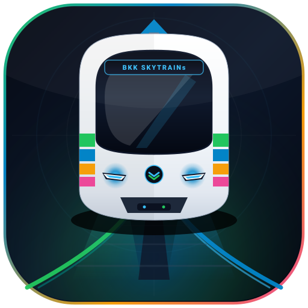
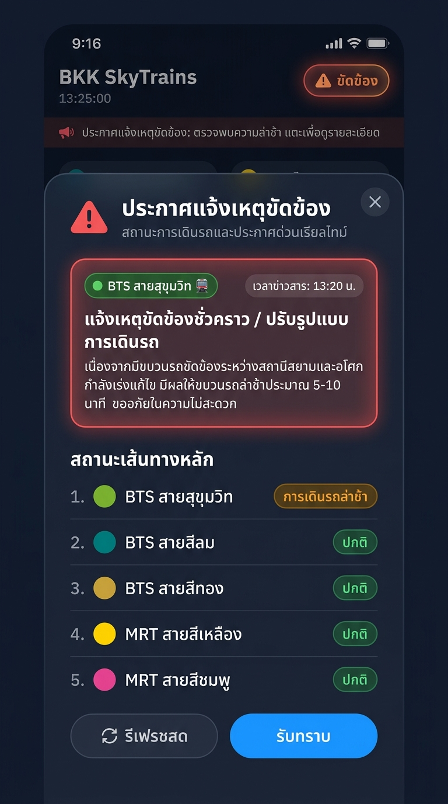

#  BKK SKYTRAINs

เว็บแอปพลิเคชันและแอปพลิเคชันมือถือ (Android & iOS) ติดตามสถานะและเวลารถไฟฟ้า BTS/MRT/SRT/ARL แบบเรียลไทม์ วางแผนการเดินทาง ข้อมูลทางออกสถานี ตารางค่าโดยสาร และเวลาเดินรถในกรุงเทพมหานครและปริมณฑลครบวงจร

---

## 🌟 จุดเด่นและฟีเจอร์หลัก (Key Features)

1.  **เช็คเวลารถไฟฟ้า BTS แบบเรียลไทม์ (Live TTA Countdown)**
   - แสดงเวลานับถอยหลังของขบวนรถไฟฟ้าที่จะเข้าเทียบชานชาลา (ชานชาลา 1 และ 2)
   - ลำดับเวลารถเข้า 3 ขบวนต่อเนื่อง พร้อมสถานะ "มาแล้ว" แบบกะพริบเตือน
   - ระบบ Reverse Proxy ดึงข้อมูลสถานะสดจาก BTS (EBM) อย่างแม่นยำ
2.  **ระบบค้นหาสถานีและทางออกใกล้คุณที่สุด (Nearest Station & Exit by GPS)**
   - คำนวณพิกัดด้วยสูตร Haversine ระบุสถานีที่ใกล้ที่สุดและระยะทางกิโลเมตรแบบเรียลไทม์
   - ชิปสถานีใกล้เคียงสำรอง (Nearest Alternate Chips) รองรับการแสดงชื่อสถานีเต็มตัวอักษร ไม่หลุดขอบ พร้อมระบบเลื่อนแนวนอนแบบนุ่มนวล (Smooth Horizontal Scroll) บนหน้าจอมือถือทุกขนาด
   - ระบบกรองขบวนรถศูนย์ซ่อมบำรุงและขบวนรถเปล่า (Depot & Empty Trains Filtering เช่น `YL00`, `PK00`) และระบบตรวจสอบเวลาเปิดให้บริการ (Operating Hours Validation: 05:30/06:00 - 24:00 น.)
   - ค้นหาประตูทางออกที่ใกล้ตำแหน่งที่คุณยืนอยู่มากที่สุด
   - รองรับ Native GPS Bridge บน Android และ iOS ผ่าน Flutter Geolocator
3.  **มาตรฐานไอคอนรูปรถไฟประจำสายสี (Project Train Icon Standard)**
   - ระบุสายสีของรถไฟฟ้าทุกสายด้วยไอคอน SVG รูปรถไฟเฉพาะประจำสายจากฟังก์ชัน `getLineIconSvg(lineId)`
   - สวยงาม คมชัดในรูปแบบ SVG Vector รองรับทุกความละเอียดหน้าจอ
4.  **มาตรฐานการจัดองค์ประกอบกึ่งกลาง (Project Element Centering Standard)**
   - ทุกกรอบข้อความ รหัสสถานี (Station Code เช่น `YL20`, `CEN`), ไอคอนสัญลักษณ์ (Icons / Symbols เช่น Theme Button, Line Icons, Badges), และปุ่มควบคุมแบบ Pill/Box ทั้งหมด ถูกจัดวางกึ่งกลางอย่างสมบูรณ์แบบทั้งแนวนอนและแนวตั้ง (Centering Layout)
5.  **แผนผังโครงข่ายรถไฟฟ้าความละเอียดสูงแบบโต้ตอบ (Transit Blueprint Vector Map & Interactive Hotspots)**
   - แผนที่โครงข่ายรวม 10 สายรถไฟฟ้า กทม. และปริมณฑล คมชัดระดับ Vector Blueprint สลับตามโหมดการแสดงผลอัตโนมัติ:
     - โหมดสว่าง (Light Theme): `bkk_transit_map.svg`
     - โหมดมืด (Dark Theme): `bkk_transit_map_dark.svg`
   - จุดฮอตสปอตสถานีแบบโต้ตอบ (Interactive Station Hotspots): แตะที่สถานีใดๆ บนแผนที่เพื่อเลือกเป็น **สถานีต้นทาง**, **สถานีปลายทาง** หรือเปิดดู **ข้อมูลประตูทางออก** ได้ทันที
   - หน้าต่างคำอธิบายสัญลักษณ์โครงข่าย (Transit Network Legend): แสดงสัญลักษณ์สายสีและจุดเชื่อมต่อสำคัญ เช่น ท่าอากาศยาน (Airport), ท่าเรือ (Pier/Boat), รถไฟทางไกล (SRT), สถานีขนส่งผู้โดยสาร (Bus Terminal), อาคารจอดแล้วจร (Park & Ride), จุดเชื่อมต่อข้ามสาย (Interchange) และสายแยกเมืองทองธานี
   - แคชออฟไลน์ระดับสูงด้วย Service Worker `bts-v73` พร้อมใช้งาน 100% แม้ไม่มีอินเทอร์เน็ต
6.  **วางแผนการเดินทางอัจฉริยะ (Smart Journey Planner)**
   - ค้นหาเส้นทางที่ดีที่สุดระหว่างสถานีต้นทางและสถานีปลายทาง
   - คำนวณเวลาเดินทางรวม, จำนวนสถานีที่ผ่าน, จุดเปลี่ยนสาย (Interchanges), และประมาณการค่าโดยสาร
7.  **ข้อมูลทางออกสถานี & จุดเชื่อมต่อ (Station Exits & Facilities)**
   - ข้อมูลประตูทางออกแต่ละด้าน บันไดเลื่อน (), ลิฟต์คนพิการ/ผู้สูงอายุ (), และทางเดินสกายวอล์ก ()
   - ข้อมูลสถานที่สำคัญ ห้างสรรพสินค้า อาคารสำนักงาน และการเชื่อมต่อระบบขนส่งสาธารณะอื่นๆ
8.  **โครงสร้างและตารางค่าโดยสาร (Fares & Pricing Guide)**
   - แสดงตารางและอัตราค่าโดยสารแยกตามสายรถไฟฟ้า พร้อมคำนวณราคาแบบไดนามิก ()
   - สรุปอัตราส่วนลดสำหรับผู้สูงอายุ (), นักเรียน/นักศึกษา (), และเด็ก ()
9.  **ตารางเวลาเดินรถ & ความถี่ (Timetables & Train Frequency)**
   - ตารางเวลาเดินรถเที่ยวแรก (First Train) และเที่ยวสุดท้าย (Last Train) ของแต่ละสาย
   - ความถี่ในการปล่อยขบวนรถ ( Headway) ทั้งในช่วงเวลาเร่งด่วน (Peak) และช่วงเวลาปกติ (Off-Peak) แยกวันทำงาน () และวันหยุด ()
10.  **สถานะการเดินรถสด & ประกาศเหตุขัดข้อง (Traffic Disruption & Incident Dialog)**
    - นำเข้าโมดูลประกาศเหตุขัดข้องและสถาปัตยกรรม UI (`TrafficTrainDialogView`) จาก `th.btsc.theskytrains`
    - แถบประกาศแจ้งเตือนด่วน (Broadcast Disruption Banner) บนหน้าหลักเมื่อพบความล่าช้าหรือเหตุขัดข้อง
    - ปุ่มสถานะแบบเรียลไทม์บนแถบหัว (Header Pill Status) แสดงสถานะ "ปกติ" / "ขัดข้อง" พร้อมเอฟเฟกต์ไฟกระพริบเตือน
    - ป๊อปอัปแจ้งเหตุขัดข้องฉบับเต็ม แสดงเวลาข่าวสาร (`AlertTime`), หัวข้อเหตุขัดข้อง (`PlanName` / `TypeName`), รายละเอียด (`Detail`), ไอคอนรถไฟประจำสาย (`getLineIconSvg`), และตารางแสดงสถานะ 5 เส้นทางหลัก (BTS สุขุมวิท, สีลม, สีทอง, MRT สีเหลือง, สีชมพู)
    - การ์ดยืนยันการเดินรถปกติ (Reassurance Card) พร้อมไอคอน `icon_traffic_information.png` เมื่อโครงข่ายเดินรถปกติ
    - โหมดทดสอบจำลองเหตุขัดข้อง (Disruption Simulation Toggle) สำหรับทดสอบการแสดงผลประกาศได้ทุกเวลา
    - 
11.  **ความปลอดภัยการสื่อสารระดับสูง (JSEncrypt API Security)**
    - ผสานการทำงานร่วมกับไลบรารี `JSEncrypt` เพื่อเข้ารหัสข้อมูล (RSA Encryption) ในการส่งคำขอข้อมูลไปยัง API ป้องกันการดักจับข้อมูลและเพิ่มเสถียรภาพในการสื่อสาร
12.  **รองรับ 2 ภาษา & โหมดถนอมสายตา (Bilingual & Dark/Light Theme)**
    - รองรับภาษาไทย (TH) และภาษาอังกฤษ (EN) เต็มรูปแบบ
    - สลับโหมดมืด (Dark Mode ) และโหมดสว่าง (Light Mode ) ได้อย่างราบรื่น
13.  **ติดตั้งได้ทั้ง PWA และ แอปมือถือเนทีฟ (PWA & Flutter App)**
    - ติดตั้งเป็น Progressive Web App บนหน้าจอมือถือได้ทันที (Add to Home Screen)
    - รองรับแอปพลิเคชันมือถือ Android & iOS (Flutter) โหลดแคชไฟล์เว็บออฟไลน์ (`assets/www/`) ทำงานได้รวดเร็ว ลื่นไหล
14.  **รองรับสายแยกเมืองทองธานี (Muang Thong Branch PK10 ⇄ MT01, MT02)**
    - กำหนดสถานีเมืองทองธานี (`PK10`) เป็นจุดเชื่อมต่อข้ามสายสำหรับสายแยก
    - การ์ดแนะนำการเปลี่ยนขบวน (Transfer Card) ที่แสดงไอคอนโมโนเรลสายสีชมพู พร้อมชานชาลาเฉพาะ (MT01 ชานชาลา 3 & 4, MT02 ชานชาลา 4)
15.  **วิดเจ็ตหน้าจอโฮมและการแจ้งเตือนสดบนหน้าจอล็อก (Home Screen Widget & Lock Screen Live Notification)**
    - **หน้าจอล็อก (Lock Screen):** แสดงการ์ดสถานีใกล้ตัวคุณ รหัสสถานี ชานชาลา 1 และชานชาลา 2 พร้อมเวลานับถอยหลังสด ผ่าน Ongoing Persistent Notification (`VISIBILITY_PUBLIC`) บน Android และระบบ Live Activities บน iOS 16.1+
    - **หน้าจอโฮม (Home Screen Widget):** แอปวิดเจ็ตบนหน้าจอหลักแสดงสถานีที่ใกล้ที่สุด ระยะทาง ชานชาลา 1 & 2 และเวลารถเข้าเทียบชานชาลาแบบเรียลไทม์ พร้อมแตะเปิดแอปตรงสู่สถานีได้ทันที

---

## 🚆 ตารางสัญลักษณ์และไอคอนประจำสายสี (Transit Line Icons & Vehicles)

สัญลักษณ์ระบุสายสี/ไลน์รถไฟฟ้าทั้งหมดในโปรเจกต์นี้ ใช้ไอคอน SVG รูปรถไฟเฉพาะตามโครงสร้างตัวรถจริงผ่านฟังก์ชัน `getLineIconSvg(lineId)`:

| Line ID | สายรถไฟฟ้า (Line Name) | รหัสสี (Hex) | ไอคอนเวกเตอร์ (Vector SVG) | สถาปัตยกรรมตัวรถ (Vehicle Architecture) |
| :---: | :--- | :---: | :---: | :--- |
| **1** | **BTS สายสุขุมวิท** (Sukhumvit Line) | `#7AB420` |  | Heavy Rail EMU รถไฟฟ้าขนาดใหญ่บนทางยกระดับ (Elevated Viaduct) |
| **2** | **BTS สายสีลม** (Silom Line) | `#00807D` |  | Heavy Rail EMU รถไฟฟ้าขนาดใหญ่บนทางยกระดับ (Elevated Viaduct) |
| **3** | **APM สายสีทอง** (Gold Line) | `#C9A038` |  | APM Automated People Mover ขบวนไร้คนขับ กระจกพานอรามา รางคอนกรีตล้อยาง |
| **4** | **MRT สายสีเหลือง** (นัคราพิพัฒน์) | `#FFD100` |  | Straddle Monorail ขบวนรถไฟฟ้าโมโนเรลคร่อมรางเดี่ยวคอนกรีต |
| **5** | **MRT สายสีชมพู** (วิวัฒน์นคร) | `#EC4899` |  | Straddle Monorail ขบวนรถไฟฟ้าโมโนเรลคร่อมรางเดี่ยวคอนกรีต พร้อมสายแยกเมืองทอง |
| **101** | **MRT สายสีน้ำเงิน** (เฉลิมรัชมงคล) | `#0284C7` |  | Underground Tunnel Metro รถไฟฟ้าอุโมงค์ใต้ดินและยกระดับวงกลม |
| **102** | **MRT สายสีม่วง** (ฉลองรัชธรรม) | `#8A2C9B` |  | Elevated Heavy Rail Metro ขบวน Sustina EMU พร้อมโครงสร้างทางยกระดับ |
| **103** | **SRTET สายสีแดงเข้ม** (ธานีรัถยา) | `#B91C1C` |  | Commuter EMU ขบวนชานเมือง (Hitachi) พร้อมเสารับไฟ Overhead Pantograph |
| **105** | **SRTET สายสีแดงอ่อน** (นครวิถี) | `#F87171` |  | Light Commuter EMU ขบวนชานเมืองพร้อมแขนรับไฟ Single-arm Pantograph |
| **104** | **ARL รถไฟฟ้าแอร์พอร์ต เรล ลิงก์** | `#8A1538` |  | Airport Express Bullet Train รถไฟฟ้าเชื่อมสนามบินสุวรรณภูมิพร้อมไอคอนเครื่องบิน |
| **201** | **BRT รถโดยสารด่วนพิเศษ** | `#82C341` |  | Bus Rapid Transit รถโดยสารปรับอากาศพร้อมช่องทางวิ่งเฉพาะ |
| **106** | **MRT สายสีส้ม** *(โครงการในอนาคต)* | `#F58220` |  | Underground Tunnel Metro รถไฟฟ้าขนส่งมวลชนเชื่อมฝั่งตะวันออก-ตก |
| **0** | **สถานีเชื่อมต่อโครงข่าย** (Transit Hub) | `#64748B` |  | สัญลักษณ์ชุมทางเชื่อมต่อโครงข่ายระบบรางทั้งหมด |

---

## 🗺️ สัญลักษณ์โครงข่ายและจุดเชื่อมต่อ (Transit Network & Legend Symbols)

สัญลักษณ์แสดงบนหน้าต่าง Transit Network Legend (`#mapLegendSheet`) และแผนผังโครงข่าย Blueprint Map:

| สัญลักษณ์เวกเตอร์ (Vector SVG) | ชื่อเรียก (Legend Name) | รายละเอียดและจุดเชื่อมต่อ (Connectivity) |
| :---: | :--- | :--- |
|  | **จุดเชื่อมต่อข้ามสาย (Interchange)** | โหนดสถานีร่วมวงกลมคู่เชื่อมโยงกัน สำหรับเปลี่ยนขบวนรถข้ามสาย (`.legend-inter-node`) |
|  | **เชื่อมต่อท่าอากาศยาน (Airport)** | เชื่อมต่อไปยังท่าอากาศยานสุวรรณภูมิ (ARL) หรือดอนเมือง (SRT Red Line) |
|  | **ท่าเรือเชื่อมต่อ (Pier / Boat)** | เชื่อมต่อเรือด่วนเจ้าพระยา หรือเรือโดยสารคลองแสนแสบ |
|  | **เชื่อมต่อรถไฟทางไกล (SRT)** | เชื่อมต่อไปยังสถานีรถไฟกรุงเทพ (หัวลำโพง) หรือสถานีกลางกรุงเทพอภิวัฒน์ |
|  | **สถานีขนส่งผู้โดยสาร (Bus Terminal)** | เชื่อมต่อไปยังสถานีขนส่งหมอชิต 2, เอกมัย หรือสายใต้ |
|  | **อาคารจอดแล้วจร (Park & Ride)** | จุดบริการอาคารจอดรถสำหรับเปลี่ยนถ่ายการเดินทางสู่ระบบราง |
|  | **สายแยกเมืองทองธานี (Branch Line)** | จุดเชื่อมต่อและชานชาลาสายแยกอิมแพ็ค-ทะเลสาบเมืองทองธานี (PK10 ⇄ MT01, MT02) |

---

## 🧭 สัญลักษณ์แถบควบคุมด้านล่าง (Floating Bottom Navigation Dock Icons)

ไอคอนควบคุมมุมมองหลักทั้ง 6 หน้าจอในแถบนำทางด้านล่าง (`nav.bottom-nav`):

| ไอคอนเวกเตอร์ (Vector SVG) | ชื่อแท็บ (Tab Name) | รหัสแท็บ (Tab ID) | การทำงานในระบบ (Functionality) |
| :---: | :--- | :---: | :--- |
|  | **หน้าแรก (Home)** | `tab-home` | กระดานสด TTA Countdown, สถานีใกล้คุณ, ค้นหาสถานี และผังเส้นทาง Strip |
|  | **แผนที่ (Map)** | `tab-map` | แผนผังโครงข่ายรถไฟฟ้าเวกเตอร์พิมพ์เขียว 12 สาย พร้อมจุดฮอตสปอตโต้ตอบ Tap-to-Route |
|  | **วางแผน (Planner)** | `tab-planner` | วางแผนการเดินทางอัจฉริยะ คำนวณเวลา ค่าโดยสาร และจุดเปลี่ยนสายข้ามทุกระบบ |
|  | **ค่าโดยสาร (Fares)** | `tab-fares` | ตารางอัตราค่าโดยสารแต่ละสาย นโยบายส่วนลด และการชำระเงิน EMV Contactless |
|  | **เวลาเดินรถ (Timetables)** | `tab-timetables` | ตารางเวลาเดินรถขบวนแรก-สุดท้าย และความถี่การปล่อยขบวนรถแยกวันทำงาน/วันหยุด |
|  | **เพิ่มเติม (More)** | `tab-more` | เมนูแฮมเบอร์เกอร์สามขีด: วิดเจ็ตแจ้งเตือนเบื้องหลังอัตโนมัติ (True Background Geofencing), สวิตช์สลับภาษา (TH/EN/ZH), สวิตช์สลับธีม (Dark/Light), และข้อมูลเวอร์ชันแอปพลิเคชัน |

---

## 🎨 ระบบไอคอนส่วนต่อประสานผู้ใช้ (Modern Vector UI Icons System)

ไอคอนระบบในไฟล์ `js/app.js` (`UI_ICONS`) ทั้ง 40 ตัว ถูกสร้างด้วย SVG Vector คมชัด รองรับการปรับขนาดและสีสันอัตโนมัติตามโหมดมืด/สว่าง:

| ไอคอนเวกเตอร์ (Vector SVG) | คีย์ (Icon Key) | การใช้งานในระบบ (Usage) |
| :---: | :--- | :--- |
|  | `pin` | หมุดระบุสถานีใกล้เคียง และตำแหน่งสถานีบนแผนผัง |
|  | `compass` | ปุ่มค้นหาตำแหน่งปัจจุบัน (GPS) และแท็บวางแผนการเดินทาง |
|  | `timer` | ความถี่ในการปล่อยขบวนรถ (Headway Frequency) และเวลานับถอยหลัง |
|  | `clock` | นาฬิกาแบบเรียลไทม์ และเวลาเปิด-ปิดการให้บริการ |
|  | `door` | ไดเรกทอรีข้อมูลประตูทางออกสถานีและจุดเชื่อมต่อ |
|  | `map` | แผนผังโครงข่ายรถไฟฟ้าเวกเตอร์แบบโต้ตอบ |
|  | `card` | แท็บข้อมูลโครงสร้างและตารางค่าโดยสาร (EMV / Contactless) |
|  | `coins` | การคำนวณค่าโดยสารแบบไดนามิกระหว่างสถานี |
|  | `ticket` | ประเภทตั๋วโดยสารเที่ยวเดียวและบัตรโดยสาร |
|  | `star` | รายการสถานีชุมทางยอดนิยม (Popular Interchange Hubs) |
|  | `bulb` | คำแนะนำการใช้งานและเกร็ดความรู้การเดินทาง |
|  | `calendar` | ตารางการเดินรถแยกวันธรรมดา (Weekday) และวันหยุด (Weekend) |
|  | `flag` | หมุดระบุสถานีปลายทางในการวางแผนเส้นทาง |
|  | `search` | กล่องค้นหารายชื่อสถานีและรหัสสถานี |
|  | `plane` | สัญลักษณ์รถไฟฟ้าแอร์พอร์ต เรล ลิงก์ และจุดเชื่อมสนามบิน |
|  | `chart` | แผนภูมิสถิติระดับความหนาแน่นของผู้โดยสาร |
|  | `walk` | ทางเดินเชื่อมและสะพานลอยคนเดิน (Skywalk) |
|  | `elevator` | สิ่งอำนวยความสะดวก: ลิฟต์โดยสารสำหรับผู้พิการและผู้สูงอายุ |
|  | `escalator` | สิ่งอำนวยความสะดวก: บันไดเลื่อนประจำทางออก |
|  | `ruler` | การวัดระยะห่างกิโลเมตรและเมตรจากพิกัด GPS |
|  | `senior` | ส่วนลดค่าโดยสารสำหรับผู้สูงอายุ (Senior Concession) |
|  | `student` | ส่วนลดค่าโดยสารสำหรับนักเรียน/นักศึกษา (Student Concession) |
|  | `child` | ส่วนลดและเกณฑ์ค่าโดยสารสำหรับเด็ก (Child Concession) |
|  | `warn` | แถบประกาศแจ้งเตือนเหตุขัดข้องและสถานะการเดินรถสด |
|  | `ban` | สัญลักษณ์แจ้งไม่มีข้อมูลขบวนรถ หรืออยู่นอกเวลาให้บริการ |
|  | `moon` | ปุ่มสลับชุดสีเข้าสู่โหมดมืด (Dark Theme) |
|  | `sun` | ปุ่มสลับชุดสีเข้าสู่โหมดสว่าง (Light Theme) |
|  | `refresh` | ปุ่มรีเฟรชข้อมูลขบวนรถและสถานะการเดินรถแบบทันที |
|  | `users` | ข้อมูลระดับความหนาแน่นของผู้โดยสารบนสถานี |
|  | `zoomIn` | ปุ่มขยายมุมมองแผนผังโครงข่ายรถไฟฟ้า |
|  | `zoomOut` | ปุ่มย่อมุมมองแผนผังโครงข่ายรถไฟฟ้า |
|  | `resetZoom` | ปุ่มคืนค่ามุมมองกึ่งกลางแผนผังโครงข่าย |
|  | `briefcase` | ตารางเวลาเดินรถช่วงวันทำงานปกติ (Weekday) |
|  | `beach` | ตารางเวลาเดินรถช่วงวันหยุดสุดสัปดาห์ (Weekend / Holiday) |
|  | `clipboard` | รายการตารางเวลาและความถี่การเดินรถประจำสาย |
|  | `check` | เครื่องหมายเลือกสถานี หรือแสดงผลชานชาลาทั้งหมด |
|  | `boat` | จุดเชื่อมต่อท่าเรือโดยสารแม่น้ำเจ้าพระยาและคลอง |
|  | `bus` | จุดเชื่อมต่อสถานีขนส่งผู้โดยสารและรถประจำทาง |
|  | `parking` | จุดบริการอาคารและลานจอดแล้วจร (Park & Ride) |

---

## 📁 โครงสร้างโปรเจกต์ 4 หมวดหมู่หลัก (Project Architecture)

โปรเจกต์แบ่งออกเป็น 4 ส่วนหลักอย่างเป็นระเบียบ:

```text
c:\Users\Administrator\Documents\BKK Sky Trains/
├── [1. Web App & PWA] (Root)
│   ├── index.html                  # หน้าเว็บแอปพลิเคชันหลัก (Transit UI & Blueprint Map)
│   ├── js/
│   │   ├── app.js                  # โค้ดควบคุมระบบหลัก (Live TTA, Planner, Routing, Fares, Hotspots)
│   │   └── jsencrypt.min.js        # ไลบรารีการเข้ารหัสความปลอดภัย API (RSA)
│   ├── api/
│   │   └── bts-proxy.js            # Universal Serverless Reverse Proxy & CORS Bypass สำหรับ BTS Live Transit API
│   ├── vercel.json                 # การตั้งค่า Deployment และ Universal CORS Routing บน Vercel
│   ├── sw.js                       # Service Worker สำหรับแคช PWA & Offline Support (bts-v73)
│   ├── manifest.json               # PWA Web App Manifest สำหรับติดตั้งบนอุปกรณ์
│   ├── Start-BKK-Transit.ps1       # สคริปต์เปิด Local Server + BTS Live API Reverse Proxy (UTF-8 BOM)
│   ├── Deploy-BKK-SkyTrains.ps1    # สคริปต์บิลด์ Android APK, ล้างข้อมูลเก่าบน GitHub และ Push อัตโนมัติ (UTF-8 BOM)
│   ├── bkk_transit_map.svg         # เวกเตอร์แผนผังรถไฟฟ้าโหมดสว่าง (Light Vector Blueprint)
│   ├── bkk_transit_map_dark.svg    # เวกเตอร์แผนผังรถไฟฟ้าโหมดมืด (Dark Vector Blueprint)
│   ├── bkk_transit_map.jpg         # รูปภาพสำรองแผนผังรถไฟฟ้า
│   ├── leaflet.css                 # สไตล์ชีตแผนที่ Leaflet
│   ├── icons/                      # ไอคอนประจำสายสี (lines/), สัญลักษณ์ (legend/), นำทาง (nav/), หน้าจอ (ui/)
│   ├── images/                     # แอสเซท Leaflet, ไอคอนแจ้งเหตุขัดข้อง (ic_traffic_alert, icon_traffic_information) และพรีวิว
│   ├── robots.txt, sitemap.xml     # การตั้งค่า SEO
│   └── *.png, *.svg, *.ico         # โลโก้และไอคอนแอปพลิเคชัน
│
├── [2. Mobile Flutter App] (bkk_skytrains_flutter/)
│   ├── android/                    # คอนฟิกูเรชันและ Build scripts ของระบบ Android
│   ├── ios/                        # คอนฟิกูเรชัน, Storyboard และ Assets ของระบบ iOS
│   ├── lib/                        # ซอร์สโค้ด Dart (BkkWebViewScreen, Theme, Services, Screens, Models)
│   ├── test/                       # ชุดทดสอบ Unit & Widget Test
│   ├── assets/www/                 # ไฟล์เว็บแคชออฟไลน์ในตัวแอป (ซิงค์ตรงกับ Root 100%)
│   └── pubspec.yaml                # รายการ Dependencies และการตั้งค่า Assets (Android & iOS)
│
├── [3. Releases & CI/CD]
│   ├── releases/                   # โฟลเดอร์เก็บไฟล์ตัวติดตั้งแอปพลิเคชัน (แบ่งแยก Android และ Apple)
│   │   ├── Android/                # ตัวติดตั้งระบบ Android
│   │   │   ├── APK/                # BKK_SkyTrains_V.xxxx.apk (.sha256)
│   │   │   └── AAB/                # BKK_SkyTrains_V.xxxx.aab (.sha256)
│   │   └── Apple/                  # ตัวติดตั้งระบบ iOS
│   │       └── IPA/                # BKK_SkyTrains_V.xxxx.ipa (.sha256)
│   └── .github/workflows/          # GitHub Actions CI/CD (build_ios.yml สำหรับบิลด์ iOS .ipa, Android .apk และ .aab อัตโนมัติ)
│
└── [4. Documentation & Specifications]
    ├── README.md                   # คู่มือภาพรวมโปรเจกต์และวิธีใช้งาน
    ├── PRD.md                      # Product Requirements Document
    ├── Skill.md                    # ข้อกำหนด Antigravity / Gemini Agent Skill
    ├── AGENTS.md                   # ข้อกำหนดและมาตรฐาน Agent ใน Workspace
    └── GEMINI.md                   # Directives & Protocols สำหรับ Gemini/Antigravity
```

---

## 🚀 วิธีเปิดใช้งาน (Getting Started)

### วิธีที่ 1: 🌐 ใช้งานผ่านหน้าเว็บออนไลน์ (Live Web PWA)
สามารถเปิดใช้งานบนเว็บเบราว์เซอร์ได้ทันที ไม่ต้องติดตั้งโปรแกรม พร้อมรองรับการติดตั้งเป็น Progressive Web App (PWA):
- 🔗 **Web PWA (GitHub Pages):** [https://nasaw9783.github.io/BKK-Sky-Trains/](https://nasaw9783.github.io/BKK-Sky-Trains/)

### วิธีที่ 2: รันเว็บแอปผ่านสคริปต์ `Start-BKK-Transit.ps1` (แนะนำสำหรับนักพัฒนาในเครื่อง)
สคริปต์จะเริ่ม Local Server พร้อมระบบ **BTS Live API Reverse Proxy** บนพอร์ต 3000 และเปิดเบราว์เซอร์ให้อัตโนมัติ:
```powershell
.\Start-BKK-Transit.ps1
```
*(หรือคลิกขวาที่ไฟล์ `Start-BKK-Transit.ps1` แล้วเลือก **Run with PowerShell**)*

### วิธีที่ 2: รันผ่าน Node.js
```bash
node -e "require('child_process').execSync('powershell ./Start-BKK-Transit.ps1', {stdio: 'inherit'})"
```

### วิธีที่ 3: ติดตั้งแอปพลิเคชัน Android (.apk / .aab)
สามารถนำไฟล์ตัวติดตั้ง Android ล่าสุดจากโฟลเดอร์ `releases/Android/` หรือจากหน้า GitHub Releases ไปติดตั้งหรือใช้งานได้ทันที:
- `releases/Android/APK/BKK_SkyTrains_V.1.3.6.apk` (Android Release APK พร้อม SHA-256 Checksum)
- `releases/Android/AAB/BKK_SkyTrains_V.1.3.6.aab` (Android App Bundle สำหรับการแจกจ่ายบน Google Play Store พร้อม SHA-256 Checksum)

### วิธีที่ 4: ติดตั้งแอปพลิเคชัน iOS (.ipa)
สามารถนำไฟล์ตัวติดตั้ง iOS ล่าสุดจากโฟลเดอร์ `releases/Apple/IPA/` หรือหน้า GitHub Releases ไป Sideload ติดตั้งบน iPhone/iPad:
- `releases/Apple/IPA/BKK_SkyTrains_V.1.3.6.ipa` (รองรับการติดตั้งผ่าน AltStore, Sideloadly, หรือ TrollStore พร้อมตรวจสอบ SHA-256 Checksum)

### วิธีที่ 5: บิลด์และดีพลอยอัตโนมัติด้วยสคริปต์ `Deploy-BKK-SkyTrains.ps1`
สคริปต์รวมกระบวนการพัฒนาและปล่อยเวอร์ชันใหม่ ทำงานตามลำดับ 8 ขั้นตอนอย่างเคร่งครัด:
```powershell
.\Deploy-BKK-SkyTrains.ps1
```
1. **จัดระเบียบไฟล์:** `C:\Users\Administrator\Documents\BKK Sky Trains` จากเครื่องให้เป็นระเบียบ พร้อมจัดหมวดหมู่/Folder ถ้าไฟล์หรือแอพไหนไม่สำคัญต่อระบบแล้ว และไม่ทำลายระบบให้เสียหาย ให้ลบทิ้งได้ทันที
2. **Update .yml ทั้งหมด:** ตรวจสอบและอัปเดตไฟล์คอนฟิก CI/CD (`.github/workflows/*.yml`, `pubspec.yaml`) ให้สอดคล้องกับเวอร์ชันปัจจุบัน
3. **Update .md ทั้งหมดให้ตรงตามเว็บ/แอพ เท่านั้น:** ตรวจสอบและอัปเดตเอกสารทุกไฟล์ (`README.md`, `PRD.md`, `AGENTS.md`, `GEMINI.md`, `Skill.md`) ให้ตรงตามเว็บ/แอพ 100%
4. **Update .ps1 ทั้งหมดให้ตรงตามเว็บ/แอพ เท่านั้น:** ตรวจสอบและอัปเดตสคริปต์ PowerShell ทั้งหมด (`Deploy-BKK-SkyTrains.ps1`, `Start-BKK-Transit.ps1`) พร้อมบันทึกด้วย UTF-8 with BOM เสมอ
5. **ทำแอพ Android:** รันการตรวจสอบคุณภาพโค้ด (node --check, flutter analyze, flutter test) และคอมไพล์ Android Release APK พร้อมคำนวณ SHA-256 Checksum
6. **ต้องการให้ทำเป็น App Bundle:** คอมไพล์ Android App Bundle (`.aab`) สำหรับการแจกจ่ายบน Google Play Store พร้อมคำนวณ SHA-256 Checksum และเคลียร์แคชบิลด์
7. **ทำแอพ IOS:** ตรวจสอบโครงสร้าง Native iOS (Info.plist, Xcode Project, AppIcons) และคอมไพล์ iOS IPA (บน macOS) หรือเตรียมส่งต่อให้ Cloud Runner
8. **ลบข้อมูลเวอร์เก่า บน Github ออก และ Upload ขึ้น Github Build iOS & Android Apps เวอร์ชั่นที่ทำใหม่ล่าสุดเสมอ:** ล้าง Releases และ Tags เก่าบน GitHub, Commit, Tag และ Push เพื่อทริกเกอร์ GitHub Actions บิลด์ iOS & Android เวอร์ชันล่าสุด

### วิธีที่ 6: รันหรือบิลด์แอปพลิเคชัน Flutter แบบแมนนวล
เข้าไปที่โฟลเดอร์ `bkk_skytrains_flutter/`:
```bash
cd bkk_skytrains_flutter
flutter pub get
flutter run
```
บิลด์ APK สำหรับติดตั้งบนเครื่อง:
```bash
flutter build apk --release
```
บิลด์ App Bundle (.aab) สำหรับ Google Play Store:
```bash
flutter build appbundle --release
```

---

## 🔄 มาตรฐานการพัฒนาและซิงค์ไฟล์ (Development Protocols)

1. **Dual-Asset Synchronization**:
   - หากมีการแก้ไข `index.html`, `js/app.js`, `js/jsencrypt.min.js`, หรือไฟล์แผนที่ในโฟลเดอร์ Root ให้คัดลอกและซิงค์ไปยัง `bkk_skytrains_flutter/assets/www/` ให้ตรงกัน 100% เสมอ
2. **Code Quality & Validation**:
   - ตรวจสอบไวยากรณ์ JavaScript: `node --check js/app.js`
   - ตรวจสอบโค้ด Flutter/Dart: `flutter analyze` ในโฟลเดอร์ `bkk_skytrains_flutter` (ต้องได้ 0 issues)
   - สคริปต์ PowerShell ทั้งหมดต้องบันทึกด้วยรูปแบบ **UTF-8 with BOM**
3. **Automated CI/CD (iOS & Android)**:
   - ระบบ CI/CD บน GitHub Actions (`.github/workflows/build_ios.yml` - "Build iOS & Android Apps") รันบน macOS runner รองรับการคอมไพล์และสร้างตัวติดตั้งทั้งสองระบบพร้อมกัน: iOS IPA (`BKK_SkyTrains_V.*.ipa`), Android APK (`BKK_SkyTrains_V.*.apk`) และ Android App Bundle (`BKK_SkyTrains_V.*.aab`) พร้อมสร้าง SHA-256 Checksum และเผยแพร่ลง GitHub Releases อัตโนมัติ (หมายเหตุ: สำหรับ Private Repository บน GitHub จำเป็นต้องตั้งค่า Spending Limit สำหรับ Actions ให้มากกว่า $0 ในหน้า Settings > Billing & plans เพื่อให้ GitHub อนุญาตให้ใช้งาน macOS Runner)
4. **Zero-Waste Pruning & Workspace Cleanliness**:
   - ถ้าไฟล์หรือแอพไหนไม่สำคัญต่อระบบแล้ว และไม่ทำลายระบบให้เสียหาย ให้ลบทิ้งได้ทันทีหลังแก้ไขหรือทดสอบไฟล์ทุกครั้ง เพื่อรักษาความสะอาดของ Workspace และความปลอดภัยของระบบ
