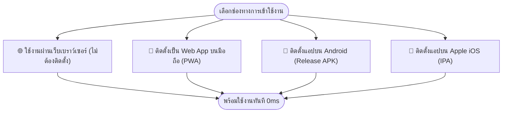
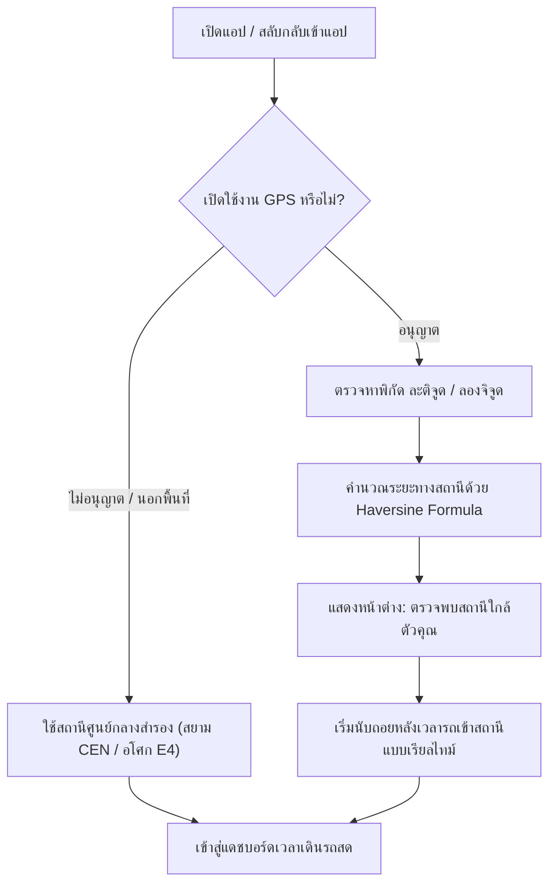
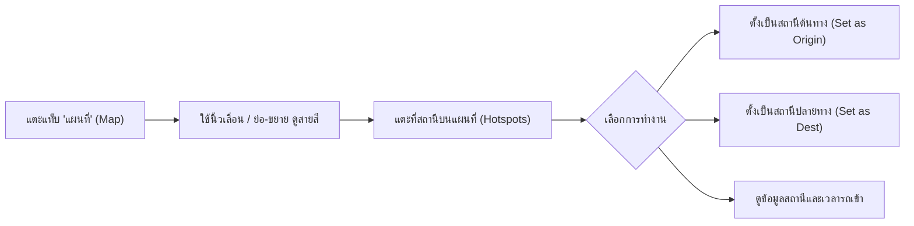

# 🚆 คู่มือการใช้งานระบบรถไฟฟ้ากรุงเทพฯ BKK SKYTRAINs
### (BKK SkyTrains Official User Guide & Commuter Handbook)

ยินดีต้อนรับสู่คู่มือการใช้งาน **BKK SKYTRAINs** ระบบติดตามเวลาขบวนรถไฟฟ้าแบบเรียลไทม์ (Live TTA), แผนที่โครงข่ายระบบรางความละเอียดสูง, ระบบวางแผนการเดินทางอัจฉริยะ, คำนวณค่าโดยสาร และรายงานสถานการณ์การเดินรถฉุกเฉิน ครอบคลุมโครงข่ายรถไฟฟ้า 12 เส้นทางทั่วกรุงเทพมหานครและปริมณฑล

---

## 📑 สารบัญ (Table of Contents)

1. [ภาพรวมและคุณสมบัติเด่นของระบบ](#1-ภาพรวมและคุณสมบัติเด่นของระบบ-overview)
2. [โครงข่ายเส้นทางรถไฟฟ้า 12 สาย](#2-โครงข่ายเส้นทางรถไฟฟ้า-12-สาย-transit-lines)
3. [การเริ่มต้นใช้งานและการติดตั้ง](#3-การเริ่มต้นใช้งานและการติดตั้ง-installation--getting-started)
   - [3.1 ใช้งานผ่านเว็บเบราว์เซอร์ทันที (Web Application)](#31-ใช้งานผ่านเว็บเบราว์เซอร์ทันที-web-application)
   - [3.2 การติดตั้งเป็น Web App บนหน้าจอหลัก (PWA: Add to Home Screen)](#32-การติดตั้งเป็น-web-app-บนหน้าจอหลัก-pwa-add-to-home-screen)
   - [3.3 การติดตั้งและอัปเดตแอปพลิเคชัน Android (APK)](#33-การติดตั้งและอัปเดตแอปพลิเคชัน-android-apk)
   - [3.4 การติดตั้งแอปพลิเคชัน Apple iOS (IPA)](#34-การติดตั้งแอปพลิเคชัน-apple-ios-ipa)
4. [หน้าหลักและระบบตรวจพบสถานีใกล้ตัวคุณ](#4-หน้าหลักและระบบตรวจพบสถานีใกล้ตัวคุณ-home--nearest-station)
   - [4.1 การเปิดใช้งานพิกัด GPS](#41-การเปิดใช้งานพิกัด-gps-location-service)
   - [4.2 ป้ายตรวจพบสถานีใกล้ตัวคุณ](#42-ป้ายตรวจพบสถานีใกล้ตัวคุณ-nearest-station-modal)
   - [4.3 แถบสถานะระบบสดและการแจ้งเตือนเหตุขัดข้อง](#43-แถบสถานะระบบสดและการแจ้งเตือนเหตุขัดข้อง-traffic-status--alerts)
   - [4.4 หน้าต่างรายละเอียดเหตุขัดข้อง (Traffic Incident Dialog)](#44-หน้าต่างรายละเอียดเหตุขัดข้อง-traffic-incident-dialog)
5. [การเช็คเวลารถไฟฟ้าและการเลือกชานชาลา](#5-การเช็คเวลารถไฟฟ้าและการเลือกชานชาลา-live-train-countdown)
   - [5.1 ลำดับขบวนรถที่จะมาถึง (ขบวนแรก ขบวนที่สอง ขบวนที่สาม)](#51-ลำดับขบวนรถที่จะมาถึง-3-ขบวนต่อเนื่อง)
   - [5.2 การสลับทิศทางและชานชาลาปลายทาง](#52-การสลับทิศทางและชานชาลาปลายทาง)
   - [5.3 สถานะรถเทียบชานชาลา ("มาแล้ว / Arrived")](#53-สถานะรถเทียบชานชาลา-arrived)
6. [การใช้งานแผนที่โครงข่ายระบบรถไฟฟ้า](#6-การใช้งานแผนที่โครงข่ายระบบรถไฟฟ้า-interactive-transit-map)
   - [6.1 การควบคุมและซูมดูแผนที่โครงข่ายเวกเตอร์](#61-การควบคุมและซูมดูแผนที่โครงข่ายเวกเตอร์)
   - [6.2 การสลับโหมดแผนที่กลางวันและกลางคืน (Theme Auto-Switching)](#62-การสลับโหมดแผนที่กลางวันและกลางคืน)
   - [6.3 การแตะสถานีบนแผนที่ (Station Hotspots)](#63-การแตะสถานีบนแผนที่-station-hotspots)
   - [6.4 สัญลักษณ์โครงข่ายและจุดเชื่อมต่อ (Transit Network Legend)](#64-สัญลักษณ์โครงข่ายและจุดเชื่อมต่อ-transit-network-legend)
7. [การวางแผนการเดินทางและทางออกสถานี](#7-การวางแผนการเดินทางและทางออกสถานี-smart-journey-planner)
   - [7.1 การเลือกสถานีต้นทางและปลายทาง](#71-การเลือกสถานีต้นทางและปลายทาง)
   - [7.2 ข้อมูลสรุปเส้นทาง จุดเปลี่ยนสาย และระยะเวลาเดินทาง](#72-ข้อมูลสรุปเส้นทาง-จุดเปลี่ยนสาย-และระยะเวลาเดินทาง)
   - [7.3 รายละเอียดประตูทางออกสถานีและสิ่งอำนวยความสะดวก](#73-รายละเอียดประตูทางออกสถานีและสิ่งอำนวยความสะดวก-exit-directory)
8. [การตรวจสอบอัตราค่าโดยสาร](#8-การตรวจสอบอัตราค่าโดยสาร-fares--pricing)
9. [ตารางเวลาเดินรถและความถี่ขบวนรถ](#9-ตารางเวลาเดินรถและความถี่ขบวนรถ-timetables--frequencies)
10. [การตั้งค่าและการปรับแต่งส่วนบุคคล](#10-การตั้งค่าและการปรับแต่งส่วนบุคคล-settings--preferences)
    - [10.1 ธีมสี (อัตโนมัติ / สว่าง / มืด)](#101-ธีมสี-theme-mode)
    - [10.2 ภาษา (ไทย / English / 中文)](#102-ภาษา-multilingual-support)
    - [10.3 ระบบศักราชและรูปแบบเวลา](#103-ระบบศักราชและรูปแบบเวลา)
    - [10.4 โหมดจำลองเหตุขัดข้อง (Simulation Toggle)](#104-โหมดจำลองเหตุขัดข้อง-disruption-simulation)
11. [คำถามที่พบบ่อยและการแก้ปัญหา](#11-คำถามที่พบบ่อยและการแก้ปัญหา-faq--troubleshooting)

---

## 1. 🌟 ภาพรวมและคุณสมบัติเด่นของระบบ (Overview)

**BKK SKYTRAINs** ถูกออกแบบขึ้นเพื่อยกระดับการเดินทางด้วยระบบขนส่งมวลชนทางรางในเขตกรุงเทพฯ และปริมณฑล โดยมีจุดเด่นสำคัญ:

- **เวลารถเข้านับถอยหลังสด (Live TTA):** คำนวณเวลานับถอยหลังแบบวินาทีต่อวินาทีตรงจากระบบควบคุมการเดินรถของ BTS และเครือข่ายพันธมิตร
- **ระบบตรวจจับสถานีใกล้คุณอัตโนมัติ:** ค้นหาสถานีและทางออกที่ใกล้พิกัด GPS ของคุณที่สุด พร้อมคำนวณระยะห่างแบบเรียลไทม์
- **รายงานเหตุการณ์ขัดข้องสด (Live Incident Broadcast):** แจ้งเตือนความล่าช้า เหตุฉุกเฉิน และแผนการเดินรถสำรองทันทีที่มีการประกาศจากศูนย์ควบคุม
- **แผนที่โครงข่ายระบบรางเวกเตอร์ (Interactive Vector Transit Map):** แผนผังเส้นทางความละเอียดสูง รองรับการซูม ขยาย และแตะเลือกสถานีได้อิสระ
- **วางแผนเส้นทางข้ามสาย (Cross-line Routing):** คำนวณเส้นทางที่ดีที่สุด จุดเปลี่ยนสาย จำนวนสถานี และค่าโดยสารรวมได้อย่างแม่นยำ
- **ทำงานได้แบบออฟไลน์ 100%:** รองรับการเรียกดูแผนที่ ผังสถานี ทางออก และตารางเวลาได้แม้ขณะอยู่ในชั้นใต้ดินหรือไม่มีสัญญาณอินเทอร์เน็ต

---

## 2. 🚆 โครงข่ายเส้นทางรถไฟฟ้า 12 สาย (Transit Lines)

ระบบ BKK SKYTRAINs รองรับและแสดงผลสัญลักษณ์ประจำสายสีด้วยไอคอนรูปรถไฟเฉพาะสาย (Project Train Icon Standard) ดังนี้:

| สายสี | ชื่อสายระบบรถไฟฟ้า | รหัสสาย | สัญลักษณ์ | ประเภทขบวนรถและลักษณะเด่น | สถานีสำคัญ / ปลายทาง |
| :--- | :--- | :---: | :---: | :--- | :--- |
| **BTS สุขุมวิท** | รถไฟฟ้าสายสีเขียวอ่อน | `1` |  | Heavy Rail EMU ทางยกระดับ | คูคต ⇄ เคหะฯ (ผ่าน สยาม, อโศก, หมอชิต) |
| **BTS สีลม** | รถไฟฟ้าสายสีลม | `2` |  | Heavy Rail EMU ทางยกระดับ | สนามกีฬาแห่งชาติ ⇄ บางหว้า (ผ่าน ศาลาแดง, สยาม) |
| **BTS สายสีทอง** | รถไฟฟ้าสายสีทอง | `3` |  | APM People Mover ไร้คนขับ | กรุงธนบุรี ⇄ คลองสาน (ผ่าน ไอคอนสยาม) |
| **MRT สายสีเหลือง** | รถไฟฟ้าสายสีเหลือง (นัคราพิพัฒน์) | `4` |  | Straddle Monorail คอนกรีตเดี่ยว | ลาดพร้าว ⇄ สำโรง (ผ่าน ศรีนครินทร์, พัฒนาการ) |
| **MRT สายสีชมพู** | รถไฟฟ้าสายสีชมพู (วิวัฒน์นคร) | `5` |  | Straddle Monorail คอนกรีตเดี่ยว | ศูนย์ราชการนนทบุรี ⇄ มีนบุรี (สายแยกเมืองทอง) |
| **MRT สายสีน้ำเงิน** | รถไฟฟ้าสายสีน้ำเงิน (เฉลิมรัชมงคล) | `101` |  | Underground Tunnel Metro | วงกลมรอบเมือง: ท่าพระ ⇄ บางซื่อ ⇄ หัวลำโพง ⇄ หลักสอง |
| **MRT สายสีม่วง** | รถไฟฟ้าสายสีม่วง (ฉลองรัชธรรม) | `102` |  | Sustina Heavy Rail Metro ยกระดับ | คลองบางไผ่ ⇄ เตาปูน |
| **SRT สายสีแดงเข้ม** | รถไฟชานเมืองสายสีแดงเข้ม (ธานีรัถยา) | `103` |  | Commuter EMU เสารับไฟ Overhead | กรุงเทพอภิวัฒน์ ⇄ รังสิต (ผ่าน สนามบินดอนเมือง) |
| **SRT สายสีแดงอ่อน** | รถไฟชานเมืองสายสีแดงอ่อน (นครวิถี) | `105` |  | Commuter EMU แขนรับไฟ Single-arm | กรุงเทพอภิวัฒน์ ⇄ ตลิ่งชัน |
| **ARL แอร์พอร์ตลิงก์** | รถไฟฟ้าเชื่อมท่าอากาศยานสุวรรณภูมิ | `104` |  | Airport Express Bullet Train | พญาไท ⇄ ท่าอากาศยานสุวรรณภูมิ (ผ่าน มักกะสัน) |
| **BRT ด่วนพิเศษ** | รถโดยสารด่วนพิเศษสาทร-ราชพฤกษ์ | `201` |  | Bus Rapid Transit ช่องทางเฉพาะ | สาทร ⇄ ราชพฤกษ์ |
| **MRT สายสีส้ม** | รถไฟฟ้าสายสีส้ม (โครงการอนาคต) | `106` |  | Underground & Elevated Metro | ศูนย์วัฒนธรรมฯ ⇄ มีนบุรี (สุวินทวงศ์) |

---

## 3. 🚀 การเริ่มต้นใช้งานและการติดตั้ง (Installation & Getting Started)

ผู้ใช้งานสามารถเลือกใช้งานระบบ BKK SKYTRAINs ได้ตามความสะดวก 4 ช่องทาง:

### 3.1 ใช้งานผ่านเว็บเบราว์เซอร์ทันที (Web Application)
- เปิดเว็บเบราว์เซอร์ใดก็ได้ เช่น Google Chrome, Safari, Microsoft Edge, Firefox
- เข้าไปยัง URL ของระบบ
- หน้าเว็บจะโหลดข้อมูลทั้งหมดขึ้นมาใช้งานได้ทันทีโดยไม่ต้องลงทะเบียนหรือติดตั้งโปรแกรมเสริมใดๆ

### 3.2 การติดตั้งเป็น Web App บนหน้าจอหลัก (PWA: Add to Home Screen)
คุณสามารถติดตั้งเว็บแอปให้มีไอคอนบนหน้าจอโทรศัพท์เหมือนแอปทั่วไป เพื่อเปิดใช้งานแบบเต็มหน้าจอ (Standalone Fullscreen):
- **บน Android (Google Chrome):**
  1. เปิดหน้าเว็บ BKK SKYTRAINs ใน Chrome
  2. แตะปุ่มเมนูจุดสามจุด `⋮` ที่มุมบนขวา
  3. เลือก **"เพิ่มลงในหน้าจอหลัก" (Add to Home screen)** หรือ **"ติดตั้งแอป" (Install app)**
  4. ยืนยันการติดตั้ง ไอคอนแอปจะปรากฏบนหน้าจอหลักของโทรศัพท์
- **บน iPhone / iPad (Safari):**
  1. เปิดหน้าเว็บ BKK SKYTRAINs ใน Safari
  2. แตะปุ่มแชร์รูปสี่เหลี่ยมมีลูกศรชี้ขึ้น `Share` ที่แถบด้านล่าง
  3. เลื่อนลงและเลือก **"เพิ่มไปยังหน้าจอโฮม" (Add to Home Screen)**
  4. แตะปุ่ม **"เพิ่ม" (Add)** ที่มุมบนขวา

### 3.3 การติดตั้งและอัปเดตแอปพลิเคชัน Android (APK)
สำหรับผู้ใช้ Android ที่ต้องการประสบการณ์การใช้งาน Native App ความเร็วสูง:
1. **ดาวน์โหลดตัวติดตั้ง:** เข้าไปยังหน้า [GitHub Releases](https://github.com/nasaw9783/BKK-Sky-Trains/releases) หรือหน้า Artifacts เลือกดาวน์โหลดไฟล์:
   - `BKK_SkyTrains_V.1.3.6_(Build 12).apk`
2. **การอนุญาตติดตั้ง:** แตะเปิดไฟล์ที่ดาวน์โหลดมา หากระบบเตือน ให้เลือก **"อนุญาตการติดตั้งจากแหล่งนี้" (Allow from this source)**
3. **กด "ติดตั้ง" (Install):** รอระบบติดตั้งสักครู่ จากนั้นกดเปิดแอปใช้งานได้ทันที

> [!TIP]
> **กรณีพบข้อผิดพลาด "ไม่ได้ติดตั้งแอปเพราะดูเหมือนว่าแพ็กเกจจะไม่ถูกต้อง":**
> เกิดจากเครื่องของท่านเคยลงเวอร์ชันก่อนหน้าที่มีลายเซ็นต์ดิจิทัลเดิมไว้ แก้ไขได้ง่ายๆ โดย **กดถอนการติดตั้ง (Uninstall) แอปเดิมออกจากเครื่อง 1 ครั้งก่อน** แล้วจึงกดติดตั้งไฟล์ `Build 12` ตัวใหม่นี้ หลังจากนั้นทุกครั้งที่มีการกดปุ่ม **Update Version** อัปเดตผ่านตัวแอป จะสามารถอัปเดตทับได้อย่างราบรื่น

#### 🔄 การอัปเดตเวอร์ชันใหม่ในตัวแอป (In-App Update)
เมื่อเปิดแอปพลิเคชันบน Android:
1. แตะแถบเมนู **"เพิ่มเติม" (More)** ที่แถบล่างสุด
2. เลื่อนลงมาที่การ์ด **"อัปเดตเวอร์ชันใหม่ (Android APK)"**
3. แตะปุ่ม **`Update Version`** ระบบจะดึงลิงก์และเริ่มดาวน์โหลดไฟล์ APK เวอร์ชันล่าสุดจาก GitHub Releases ให้โดยตรง

### 3.4 การติดตั้งแอปพลิเคชัน Apple iOS (IPA)
สำหรับผู้ใช้งาน iPhone หรือ iPad สามารถดาวน์โหลดไฟล์ `BKK_SkyTrains_V.1.3.6_(Build 12).ipa` และติดตั้งแบบ Sideload:
1. ดาวน์โหลดไฟล์ `.ipa` จากหน้า GitHub Releases
2. นำไปติดตั้งผ่านเครื่องมือจัดการแอป เช่น **AltStore**, **Sideloadly** หรือ **TrollStore**

---

## 4. 🧭 หน้าหลักและระบบตรวจพบสถานีใกล้ตัวคุณ (Home & Nearest Station)

หน้าหลักถูกออกแบบมาเพื่อให้คุณทราบข้อมูลการเดินทางที่สำคัญที่สุดได้ภายในเสี้ยววินาที

### 4.1 การเปิดใช้งานพิกัด GPS (Location Service)
เมื่อเปิดแอปครั้งแรก ระบบจะขออนุญาตเข้าถึงตำแหน่งของคุณ (`Allow Location Access`):
- กรุณาเลือก **"อนุญาตขณะใช้งานแอป" (While using the app)** หรือ **"อนุญาตเสมอ"** เพื่อให้ระบบค้นหาสถานีและทางออกที่ใกล้ตัวคุณได้แม่นยำที่สุด
- ระบบใช้การคำนวณระยะทางแบบ **Haversine Formula** บนเครื่องของคุณ โดยไม่มีการส่งพิกัดส่วนบุคคลไปยังเซิร์ฟเวอร์ภายนอก

### 4.2 ป้ายตรวจพบสถานีใกล้ตัวคุณ (Nearest Station Modal)
เมื่อระบบตรวจพบสถานีที่ใกล้ที่สุด จะแสดงหน้าต่างการ์ดสรุปสถานะ:
- **รหัสและชื่อสถานี:** เช่น `YL20 ศรีด่าน` หรือ `CEN สยาม` พร้อมไอคอนสีประจำสาย
- **ระยะห่าง:** ระบุระยะห่างจากตำแหน่งปัจจุบันของคุณ เช่น `490 ม.` หรือ `1.2 กม.`
- **เวลานับถอยหลังสด:** แสดงชานชาลาและเวลารถไฟฟ้าที่จะเข้าเทียบสถานี

> [!NOTE]
> **รอบการแสดงหน้าต่างตรวจพบสถานี:**
> เพื่อความสะดวกในการใช้งาน ไม่รบกวนหน้าจอขณะกำลังดูข้อมูลอื่น หน้าต่างตรวจพบสถานีจะปรากฏเฉพาะ:
> 1. ตอนเปิดเข้าสู่แอปพลิเคชัน
> 2. เมื่อสลับกลับเข้าแอปหลังจากพับหน้าจอไปใช้งานแอปอื่นชั่วคราว
> 3. เมื่อดึงหน้าจอลงสุดเพื่อโหลดใหม่ (Pull to Refresh)

### 4.3 แถบสถานะระบบสดและการแจ้งเตือนเหตุขัดข้อง (Traffic Status & Alerts)
- **Header Control Pill:** แถบรูปแคปซูลบริเวณด้านบนของจอ แสดงสถานะภาพรวมของระบบ:
  - ไฟสีเขียว `ปกติ` (Normal Service): ขบวนรถทุกสายให้บริการตามตารางเวลาปกติ
  - ไฟสีแดง/ส้ม `ขัดข้อง` (Service Delay / Disruption): มีเหตุขัดข้อง ความล่าช้า หรือการปรับแผนเดินรถ
- **Broadcast Disruption Banner:** เมื่อเกิดเหตุขัดข้อง จะมีแถบเตือนสีแดงกะพริบแจ้งเตือนที่ด้านบนสุดของหน้าหลัก พร้อมหัวข้อเหตุการณ์และปุ่มกดเพื่อดูรายละเอียดฉบับเต็ม

### 4.4 หน้าต่างรายละเอียดเหตุขัดข้อง (Traffic Incident Dialog)
เมื่อแตะที่ปุ่มสถานะหรือแถบแจ้งเตือน ระบบจะเปิดหน้าต่างข้อมูลสถานการณ์ฉุกเฉิน:
- **เวลาที่เกิดเหตุ (Alert Time):** เวลาที่ศูนย์ควบคุมออกประกาศ
- **ประเภทเหตุการณ์ (Plan Name / Incident Type):** เช่น สภาพอากาศ, ระบบอาณัติสัญญาณขัดข้อง, หรือการเปลี่ยนขบวนรถ
- **รายละเอียดเหตุการณ์ (Detail):** ข้อความชี้แจงสถานการณ์ และสถานีหรือช่วงที่ได้รับผลกระทบ
- **ตารางความพร้อม 5 สายหลัก:** สรุปสถานะการเดินรถของ BTS สุขุมวิท, BTS สีลม, BTS สายสีทอง, MRT สายสีเหลือง และ MRT สายสีชมพู
- **การ์ดรับรองสถานะการเดินรถปกติ (Reassurance Card):** แสดงเมื่อการเดินรถทุกสายเป็นปกติ ไร้ปัญหาขัดข้อง

---

## 5. ⏱️ การเช็คเวลารถไฟฟ้าและการเลือกชานชาลา (Live Train Countdown)

ระบบนับถอยหลังของ BKK SKYTRAINs เชื่อมต่อตรงกับระบบควบคุมการเดินรถ ดึงข้อมูลสดทุก 20 วินาที และนับถอยหลังทุก 1 วินาที:

### 5.1 ลำดับขบวนรถที่จะมาถึง (3 ขบวนต่อเนื่อง)
ในแต่ละชานชาลา ระบบจะแสดงรายการขบวนรถที่จะมาถึงต่อเนื่องสูงสุด 3 ลำดับ:
1. **ขบวนแรก (Next Train):** แสดงเวลานับถอยหลังขนาดใหญ่ เช่น `02:45` (อีก 2 นาที 45 วินาที)
2. **ขบวนที่สอง (2nd Train):** แสดงเวลาขบวนถัดไป เช่น `07:15`
3. **ขบวนที่สาม (3rd Train):** แสดงเวลาขบวนลำดับที่สาม เช่น `12:30`

### 5.2 การสลับทิศทางและชานชาลาปลายทาง
- แตะที่แถบเลือกชานชาลา **ชานชาลา 1 (Platform 1)** หรือ **ชานชาลา 2 (Platform 2)** เพื่อดูเวลารถฝั่งที่ต้องการเดินทาง
- แต่ละชานชาลาจะระบุชื่อสถานีปลายทางไว้อย่างชัดเจน (เช่น `ปลายทาง: เคหะฯ` หรือ `ปลายทาง: คูคต`)

### 5.3 สถานะรถเทียบชานชาลา ("มาแล้ว / Arrived")
- เมื่อเวลานับถอยหลังลดลงจนเหลือ `00:00` หรือรถเข้าจอดเทียบชานชาลาแล้ว กล่องเวลาจะเปลี่ยนเป็นสีแดงพร้อมข้อความกะพริบ **"มาแล้ว / Arrived"**
- ช่วยให้คุณตัดสินใจได้ทันทีว่าควรเร่งเดินขึ้นชานชาลา หรือรอขบวนถัดไป

---

## 6. 🗺️ การใช้งานแผนที่โครงข่ายระบบรถไฟฟ้า (Interactive Transit Map)

ระบบแผนที่ใน BKK SKYTRAINs เป็นแผนผังเส้นทางเวกเตอร์คุณภาพสูง (Vector Blueprint Map) ที่คมชัดทุกระดับการซูม

### 6.1 การควบคุมและซูมดูแผนที่โครงข่ายเวกเตอร์
- แตะที่แท็บ **"แผนที่" (Map)** ที่แถบนำทางด้านล่าง
- **ใช้นิ้วซูม (Pinch-to-zoom):** กางสองนิ้วออกเพื่อซูมเข้า หรือหุบนิ้วเข้าเพื่อซูมออก
- **เลื่อนแผนที่ (Pan):** ใช้นิ้วปาดเลื่อนไปยังย่านหรือแนวเส้นทางที่ต้องการดู
- **ปุ่มจัดกึ่งกลาง (Reset View):** แตะเพื่อดึงมุมมองแผนที่กลับมาที่ศูนย์กลางโครงข่าย

### 6.2 การสลับโหมดแผนที่กลางวันและกลางคืน
- ระบบจะสลับธีมของแผนผังเส้นทางอัตโนมัติตามโหมดที่คุณใช้งาน:
  - **Light Mode Map:** แผนที่พื้นหลังสว่าง เหมาะสำหรับดูในที่แสงจ้ากลางแจ้ง
  - **Dark Mode Map:** แผนที่พื้นหลังสีเข้ม (Deep Slate Dark) สบายตาเมื่อใช้งานในที่แสงน้อย

### 6.3 การแตะสถานีบนแผนที่ (Station Hotspots)
ทุกสถานีบนแผนที่มีจุดสัมผัส (Hotspot) ให้แตะได้ทันที:
- เมื่อแตะสถานี จะมีเมนูขึ้นมาให้เลือก:
  - 🟢 **ตั้งเป็นสถานีต้นทาง (Set as Origin)**
  - 🔴 **ตั้งเป็นสถานีปลายทาง (Set as Destination)**
  - ℹ️ **ดูรายละเอียดสถานี (View Station Info)**: เปิดตารางเวลา ทางออก และเวลานับถอยหลังของสถานีนั้น

### 6.4 สัญลักษณ์โครงข่ายและจุดเชื่อมต่อ (Transit Network Legend)
แตะปุ่ม **"คำอธิบายสัญลักษณ์" (Legend)** เพื่อดูความหมายของสัญลักษณ์ต่างๆ บนแผนผัง:

| สัญลักษณ์ | ความหมาย | รายละเอียดการเชื่อมต่อ |
| :---: | :--- | :--- |
|  | **จุดเชื่อมต่อข้ามสาย (Interchange)** | สถานีร่วมวงกลมคู่ที่สามารถเดินเปลี่ยนสายรถไฟฟ้าข้ามค่ายได้ |
|  | **เชื่อมต่อท่าอากาศยาน (Airport)** | จุดเชื่อมต่อไปยังสนามบินสุวรรณภูมิ (ARL) หรือสนามบินดอนเมือง (SRT แดง) |
|  | **ท่าเรือเชื่อมต่อ (Pier / Boat)** | เชื่อมต่อไปยังท่าเรือด่วนเจ้าพระยา (เช่น สะพานตากสิน) หรือเรือคลองแสนแสบ |
|  | **เชื่อมต่อรถไฟทางไกล (SRT Intercity)** | เชื่อมต่อไปยังสถานีกลางกรุงเทพอภิวัฒน์ หรือสถานีรถไฟกรุงเทพ (หัวลำโพง) |
|  | **สถานีขนส่งผู้โดยสาร (Bus Terminal)** | เชื่อมต่อสถานีขนส่งหมอชิต 2, สถานีขนส่งเอกมัย หรือสายใต้ |
|  | **อาคารจอดแล้วจร (Park & Ride)** | ลานและอาคารจอดรถสำหรับผู้โดยสารที่นำรถยนต์ส่วนตัวมาต่อรถไฟฟ้า |
|  | **สายแยกเมืองทองธานี (Branch Line)** | ชานชาลาสายแยกอิมแพ็ค เมืองทองธานี (PK10 เมืองทองธานี ⇄ MT01 ⇄ MT02) |

---

## 7. 🎯 การวางแผนการเดินทางและทางออกสถานี (Smart Journey Planner)

### 7.1 การเลือกสถานีต้นทางและปลายทาง
1. แตะที่แท็บ **"วางแผน" (Plan)** ที่แถบนำทางด้านล่าง
2. เลือก **สถานีต้นทาง (From)**: พิมพ์ชื่อสถานี รหัสสถานี หรือเลือกจากรายชื่อตามสายสี
3. เลือก **สถานีปลายทาง (To)**: พิมพ์หรือเลือกสถานีปลายทางที่ต้องการไป
4. หรือแตะปุ่ม **"สลับต้นทาง-ปลายทาง" `⇄`** เพื่อสลับทิศทางการเดินทางได้ทันที

### 7.2 ข้อมูลสรุปเส้นทาง จุดเปลี่ยนสาย และระยะเวลาเดินทาง
ระบบจะประมวลผลด้วยอัลกอริทึมกราฟเครือข่าย เพื่อหาเส้นทางที่รวดเร็วและสะดวกที่สุด โดยแสดงผลสรุป:
- ⏱️ **ระยะเวลาเดินทางโดยประมาณ (Estimated Time):** เช่น `32 นาที`
- 🚉 **จำนวนสถานีที่ผ่าน (Total Stations):** เช่น `14 สถานี`
- 🔄 **จุดเปลี่ยนสาย (Transfers):** แนะนำสถานีที่ต้องเปลี่ยนขบวน พร้อมระบุชานชาลาและสายสีที่ต้องต่อไป
- 💵 **ค่าโดยสารรวมโดยประมาณ (Estimated Fare):** คำนวณค่าโดยสารรวมข้ามทุกสายให้เบื้องต้น
- 📋 **ขั้นตอนการเดินทางทีละสเต็ป (Step-by-Step Directions):** แสดงผังเส้นทางแต่ละช่วงพร้อมไอคอนประจำสายสี

### 7.3 รายละเอียดประตูทางออกสถานีและสิ่งอำนวยความสะดวก (Exit Directory)
เมื่อเลือกดูข้อมูลสถานี คุณสามารถตรวจสอบ:
- **หมายเลขประตูทางออก (Exit 1, Exit 2, Exit 3...):** บอกชื่ออาคาร ห้างสรรพสินค้า โรงพยาบาล หรือซอยสำคัญของแต่ละทางออก
- **สิ่งอำนวยความสะดวก:**
  - 🛗 ลิฟต์โดยสารสำหรับผู้พิการและผู้สูงอายุ (Elevator)
  - 🪜 บันไดเลื่อนขึ้น-ลง (Escalator)
  - 🚶 ทางเชื่อมสกายวอล์ก (Skywalk Direct Access)
  - 🚻 ห้องน้ำสาธารณะ และจุดจำหน่ายตั๋ว

---

## 8. 💰 การตรวจสอบอัตราค่าโดยสาร (Fares & Pricing)

แตะที่แท็บ **"ค่าโดยสาร" (Fare)** เพื่อตรวจสอบโครงสร้างราคา:
- **คำนวณราคาแบบจับคู่สถานี:** เลือกต้นทางและปลายทางเพื่อดูราคาที่แน่นอน
- **ประเภทบัตรและส่วนลด:**
  - บุคคลทั่วไป (Adult / Standard Token & Card)
  - นักเรียน / นักศึกษา (Student Pass - อายุไม่เกิน 23 ปี)
  - ผู้สูงอายุ (Senior Citizen Pass - อายุ 60 ปีขึ้นไป ลด 50%)
- **นโยบายเพดานค่าโดยสาร / ตั๋วร่วม:** แสดงข้อมูลนโยบายค่าโดยสารสูงสุดและเงื่อนไขการยกเว้นค่าแรกเข้าเมื่อเปลี่ยนสาย

---

## 9. 🕒 ตารางเวลาเดินรถและความถี่ขบวนรถ (Timetables & Frequencies)

แตะที่แท็บ **"เวลาเดินรถ" (Timetable)** เพื่อตรวจสอบข้อมูลเวลา:
- **ขบวนรถเที่ยวแรก (First Train):** เวลาปล่อยรถเที่ยวแรกของแต่ละสถานี (ช่วงเวลาประมาณ 05:30 - 06:00 น.)
- **ขบวนรถเที่ยวสุดท้าย (Last Train):** เวลาตัดขบวนรถเที่ยวสุดท้าย (ช่วงเวลาประมาณ 23:45 - 24:00 น.)
- **ความถี่ในการเดินรถ (Headway):**
  - **ช่วงเวลาเร่งด่วน (Peak Hours):** เช้า 07:00 - 09:00 น. และเย็น 17:00 - 20:00 น. (ความถี่ประมาณ 2.5 - 4 นาทีต่อขบวน)
  - **ช่วงเวลานอกชั่วโมงเร่งด่วน (Off-Peak Hours):** ความถี่ประมาณ 5 - 8 นาทีต่อขบวน
  - **วันเสาร์-อาทิตย์และวันหยุดนักขัตฤกษ์:** ความถี่ประมาณ 6 - 8 นาทีต่อขบวน

---

## 10. ⚙️ การตั้งค่าและการปรับแต่งส่วนบุคคล (Settings & Preferences)

แตะที่แท็บ **"เพิ่มเติม" (More)** เพื่อปรับแต่งประสบการณ์ใช้งานให้เหมาะกับคุณ:

### 10.1 ธีมสี (Theme Mode)
- **อัตโนมัติตามระบบ (System Auto):** เปลี่ยนตามโหมดของระบบปฏิบัติการโทรศัพท์ของคุณ
- **โหมดสว่าง (Light Mode):** สีขาวสะอาดตา อ่านง่ายในที่กลางแจ้ง
- **โหมดมืด (Dark Mode):** สี Deep Slate Dark สบายตา ประหยัดพลังงานแบตเตอรี่บนหน้าจอ OLED

### 10.2 ภาษา (Multilingual Support)
สลับภาษาการแสดงผลได้ทันทีโดยไม่ต้องโหลดหน้าเว็บใหม่:
- 🇹🇭 **ภาษาไทย (TH):** ภาษาเริ่มต้น แสดงชื่อสถานีและประกาศเป็นภาษาไทย
- 🇬🇧 **English (EN):** แสดงชื่อสถานีและอินเทอร์เฟซทั้งหมดเป็นภาษาอังกฤษ
- 🇨🇳 **中文 (ZH):** แสดงชื่อสถานีและส่วนควบคุมเป็นภาษาจีน

### 10.3 ระบบศักราชและรูปแบบเวลา
- **ระบบศักราช:** เลือกแสดงผลเป็น **พุทธศักราช (พ.ศ.)** หรือ **คริสต์ศักราช (ค.ศ.)**
- **รูปแบบเวลา:** เลือกแสดงเวลาแบบ **24 ชั่วโมง (เช่น 14:30 น.)** หรือ **12 ชั่วโมง (เช่น 02:30 PM)**

### 10.4 โหมดจำลองเหตุขัดข้อง (Disruption Simulation)
สำหรับผู้ใช้ที่ต้องการทดสอบการทำงานของระบบแจ้งเตือน สามารถเปิดสวิตช์ **"จำลองเหตุขัดข้อง" (Simulate Disruption)** เพื่อดูตัวอย่างการแสดงผลแถบเตือนสีแดง, การเปิดหน้าต่าง `TrafficTrainDialogView`, และการเปลี่ยนสถานะของระบบแบบเสมือนจริง

---

## 11. ❓ คำถามที่พบบ่อยและการแก้ปัญหา (FAQ & Troubleshooting)

### Q1: เปิดแอปแล้วขึ้นว่า "ไม่พบตำแหน่งของคุณ" หรือระบบแสดงสถานีอโศก/สยามแทน?
- **สาเหตุ:** เบราว์เซอร์หรือโทรศัพท์ยังไม่ได้รับอนุญาตให้เข้าถึงตำแหน่ง GPS
- **วิธีแก้ไข:**
  1. ตรวจสอบว่าเปิด GPS (Location Services) บนโทรศัพท์แล้ว
  2. แตะที่ไอคอนแม่กุญแจ `🔒` หน้าแถบ URL ของเบราว์เซอร์ เลือก **"สิทธิ์เข้าถึงตำแหน่ง" (Location)** และกดเป็น **"อนุญาต" (Allow)**
  3. ดึงหน้าจอลงสุดเพื่อโหลดใหม่ (Pull to Refresh)

### Q2: เวลารถเข้านับถอยหลังขึ้นสถานะ "กำลังโหลดข้อมูล..." ค้างหรือไม่เดินต่อ?
- **สาเหตุ:** สัญญาณอินเทอร์เน็ตขาดหาย หรืออยู่นอกเวลาให้บริการ (หลัง 24:00 น. ถึงก่อน 05:30 น.)
- **วิธีแก้ไข:**
  1. ตรวจสอบการเชื่อมต่ออินเทอร์เน็ต (4G/5G/Wi-Fi)
  2. หากอยู่นอกเวลาให้บริการ ระบบจะแสดงเวลาตามตารางเที่ยวแรกของวันถัดไปแทน

### Q3: ติดตั้งไฟล์ APK บน Android แล้วขึ้นว่า "ไม่ได้ติดตั้งแอปเพราะดูเหมือนว่าแพ็กเกจจะไม่ถูกต้อง"?
- **สาเหตุ:** ในเครื่องมีแอปเวอร์ชันทดสอบเดิมที่มีลายเซ็นต์ความปลอดภัยไม่ตรงกับ Release Version ปัจจุบัน
- **วิธีแก้ไข:**
  1. กดแตะค้างที่ไอคอนแอป BKK SkyTrains บนหน้าจอ แล้วเลือก **"ถอนการติดตั้ง" (Uninstall)**
  2. เปิดโฟลเดอร์ดาวน์โหลด แล้วแตะติดตั้งไฟล์ `BKK_SkyTrains_V.1.3.6_(Build 12).apk` ใหม่อีกครั้ง
  3. เมื่อติดตั้งสำเร็จแล้ว ในอนาคตจะสามารถกดปุ่ม **Update Version** อัปเดตทับได้ทันที

### Q4: สามารถใช้งานแอปขณะไม่มีสัญญาณอินเทอร์เน็ตได้หรือไม่?
- **ตอบ:** ได้อย่างสมบูรณ์แบบสำหรับ:
  - การดูแผนที่โครงข่ายระบบรถไฟฟ้า
  - การค้นหารายชื่อสถานี ข้อมูลทางออก และสิ่งอำนวยความสะดวก
  - การวางแผนเส้นทางและคำนวณค่าโดยสาร
  - การดูตารางเวลาเดินรถเที่ยวแรก-เที่ยวสุดท้าย
  *(หมายเหตุ: เฉพาะเวลานับถอยหลังสดและข่าวสารเหตุขัดข้องเรียลไทม์เท่านั้นที่ต้องใช้อินเทอร์เน็ต)*

---

**BKK SKYTRAINs — Real-time Bangkok SkyTrains transit tracking app**  
*พัฒนาเพื่ออำนวยความสะดวกแก่ผู้โดยสารรถไฟฟ้าทุกคนในกรุงเทพฯ และปริมณฑล*
